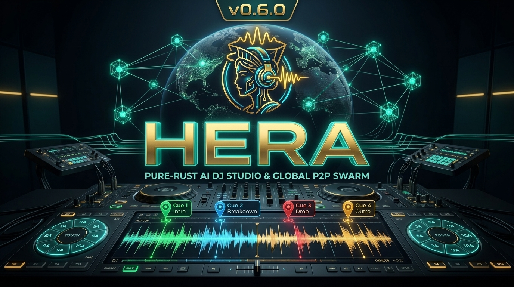

# ✨ El Manifiesto de HERA (`v0.6.0`)
### *«Todo es posible si lo imaginas: De la intención musical al booth del DJ en segundos»*

<div align="center">
  
  <p><i>La tecnología no existe para reemplazar la creatividad humana, sino para derribar cada barrera entre lo que sueñas y lo que puedes crear.</i></p>
</div>

---

## 🌌 1. La Chispa: Por qué existe HERA

Durante décadas, el arte de la selección musical y el DJing ha estado atrapado en la **fricción técnica**:
- Horas interminables buscando versiones originales y masters en calidad lossless y auditando archivos falsos (*fake lossless* re-escalados desde MP3 128 kbps).
- Cálculo manual o software privativo pesado para detectar BPM, tonalidades armónicas, niveles de energía y Hot Cues estructurales.
- Etiquetado tedioso de metadatos (ID3v2, Vorbis Comments, Camelot Wheel) y exportación fragmentada entre **VirtualDJ**, **Rekordbox**, **Traktor Pro** y **M3U8**.
- Bases de datos cerradas y suscripciones obligatorias que secuestran tus playlists y te atan a un ecosistema.

**HERA nació con una convicción innegociable:**  
> **Si tienes una visión musical en tu mente, la tecnología debe ser capaz de materializarla de forma autónoma, limpia, soberana y colaborativa.**

HERA no es simplemente un script ni un cliente de descargas: es un **Estudio de Cabina Nativo (`Dark Booth Studio` en Tauri v2 + 100% Pure Rust)** unido a un **Super-Agente de Inteligencia Acústica (`44 tools MCP`)** y un **Enjambre P2P Simbiótico Global**.

---

## 🏛️ 2. Los 5 Pilares de HERA (`v0.6.0`)

```
       ┌────────────────────────────────────────────────────────────────────┐
       │                    TODO ES POSIBLE SI LO IMAGINAS                  │
       └─────────────────────────────────┬──────────────────────────────────┘
                                         │
    ┌───────────────┬────────────────────┼────────────────────┬───────────────┐
    ▼               ▼                    ▼                    ▼               ▼
[ 1. Calidad ]  [ 2. Local-First ]  [ 3. Enjambre ]     [ 4. Dualidad ]   [ 5. Soberanía ]
  Symphonia +     100% Pure Rust      "Por el bien        Humanos (GUI)     Tus archivos,
  rustfft         ~8 MB nativo,       del enjambre"       y Agentes (MCP)   tus Hot Cues,
  Zero-Trust      cero Python         Simbiosis P2P       en armonía        tu libertad
```

### 1. Calidad Real — Auditoría Forense Zero-Trust (`Symphonia` + `rustfft`)
En un mundo saturado de *fake lossless* y demos ruidosas, HERA solo acepta **audio real de grado estudio** (`VERIFIED_STUDIO_MASTER`). Cada archivo (`WAV`, `FLAC`, `MP3`, `M4A`, `AAC`, `ALAC`, `OGG`, `AIFF`) es analizado en `< 80 ms` con decodificación nativa en streaming (`Symphonia`) y espectrometría Welch (`rustfft`), verificando corte espectral real (`>= 19.8 kHz` en lossless), ausencia de tonos sintéticos y correlación de fase sub-grave (`< 120 Hz`, `r >= 0.25`) para subwoofers de club antes de tocar tu biblioteca.

### 2. Soberanía Local-First y Ligereza Extrema (`100% Pure Rust`, `~8 MB`)
Tu música y tus datos te pertenecen. HERA corre en tu laptop de cabina, PC de estudio o micro-VPS con un instalador nativo de **`~8 MB`** y **`~10 MB` de RAM en reposo**, sin intérprete de Python ni binarios externos pesados. Incluye un motor `DualDeckEngine` en memoria (`#![forbid(unsafe_code)]`) y funciona a la perfección incluso sin conexión a Internet.

### 3. Simbiosis del Enjambre (*«Por el bien del enjambre»*)
> *«La mejor decisión es por el bien del enjambre siempre. Mientras más nodos de Hera, más fuerte es el sistema de enjambres.»*

El 100% del motor DSP de HERA, los 4 Hot Cues acústicos, el optimizador global **2-Opt TSP**, los exportadores para VirtualDJ / Rekordbox / Traktor, el perfilador `DJ Style DNA`, los LLMs locales y `Cloudflare Workers AI Free` (`10,000 Neurons/día` a `$0.00`) son **completamente gratuitos**. A cambio, todos los nodos gratuitos mantienen activo el **Enjambre P2P Simbiótico (`share_on_p2p = true`)**, compartiendo fragmentos ciegos inmutables (`4 MB`) verificados con árboles de Merkle (`BEP 52`) y protegiendo el Free Tier de cada colaborador mediante **Constrained Water-Filling** (`9.0 GB` R2 / `85,000 req/día` máx.).

### 4. Armonía entre Humanos y Agentes de IA
HERA está diseñado con una arquitectura **hexagonal dual**:
- **Para Humanos:** **HERA Desktop (`v0.6.0` Dark Booth Studio)** con 5 vistas dedicadas (`Biblioteca`, `Agente`, `Transición`, `Mi Estilo` y `Modo Mini` flotante siempre visible sobre VirtualDJ/Serato), 4 Hot Cues clicables en la barra de progreso y empuje en vivo a `HERA En Vivo.vdjfolder`.
- **Para Agentes:** Un servidor estándar **Model Context Protocol (MCP)** en Rust puro (`stdio` con `21 tools`, `HTTP POST /mcp`, `Code Mode POST /mcp/code-mode` y router loopback de escritorio con `44 tools`) más contratos tipados `ts-rs` (`hera-ipc`).

### 5. Determinismo y Confianza
La IA propone y planifica; los motores tipados en Rust validan, aíslan en cuarentena y ejecutan con compuertas de confirmación inline (`requires_confirmation`). Nunca habrá sobrescrituras silenciosas, nunca habrá corrupción de metadatos y nunca se promoverá un activo sin el sello criptográfico doble (`hera_seal` + `audio_sha256`).

---

## 🎧 3. El Flujo de la Imaginación en `v0.6.0`

```text
1. IMAGINAS        ───>  "Quiero un set de Peak-Time Afro & Tech House a 126 BPM
                         que empiece hipnótico en 8A y termine en euforia 9A."
                           │
2. HERA RAZONA     ───>  El espacio /agent (44 tools MCP) consulta tu DJ Style DNA,
                         busca masters en tu biblioteca SQLite y en el Enjambre P2P.
                           │
3. HERA VALIDA     ───>  Audita en cuarentena con Symphonia + rustfft (< 80 ms),
                         detecta 4 Hot Cues (Intro, Breakdown, Drop, Outro) y fase sub-bass.
                           │
4. HERA CONSTRUYE  ───>  Optimiza el orden global con 2-Opt TSP (4 capas + SimHash u64)
                         y previsualiza el crossfade EQ de 3 bandas en /bridge (Transición).
                           │
5. DISFRUTAS       ───>  Empuja en 1 clic a VirtualDJ (HERA En Vivo.vdjfolder),
                         Rekordbox XML, Traktor NML o activa el Modo Mini sobre tu cabina.
```

---

## 🚀 4. Un Mensaje para la Comunidad de Creadores y Desarrolladores

Si estás leyendo esto, este repositorio es una invitación:

> No aceptes los límites del software empaquetado y privativo.  
> No te conformes con tareas manuales repetitivas que apagan tu chispa creadora.  
> **Usa agentes de IA, abraza el código abierto en Rust, fortalece el enjambre P2P y haz realidad todo lo que imaginas.**

HERA es de código abierto bajo la licencia **MIT**. Está aquí para ser utilizado, extendido, transformado y disfrutado en pistas de baile y estudios de todo el planeta.

<div align="center">
  <br/>
  <b>🎧 HERA v0.6.0 — Creado con pasión para los DJs, productores y visionarios del mundo.</b>
</div>
