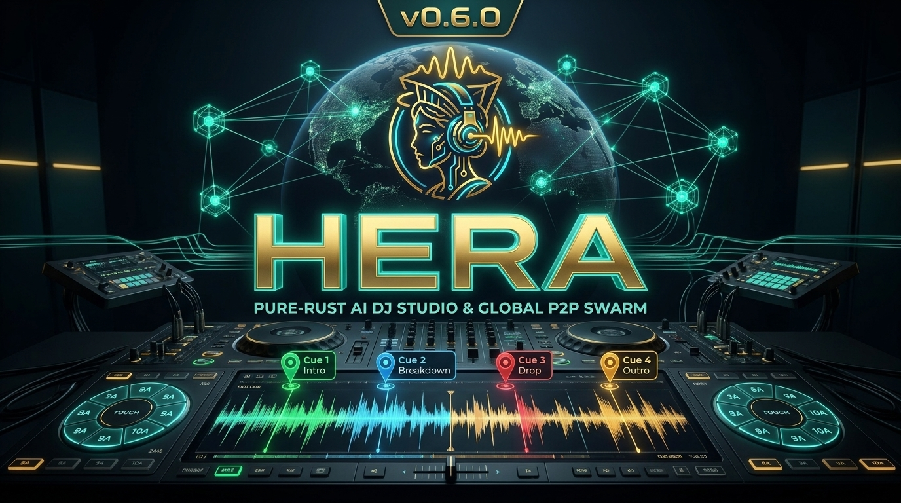

<div align="center">



# 🎧 HERA
### *The Autonomous, Local-First AI Super-Agent for DJs & Music Curators*

**«Todo es posible si lo imaginas: De la intención musical al booth del DJ en segundos»**

[](hera-rs/)
[](hera-desktop/)
[](LICENSE)
[](https://modelcontextprotocol.io/)
[](https://workers.cloudflare.com/)
[](AGENTS.md)
[](MANIFESTO.md)

<p align="center">
  <b>Hera</b> is an intelligent, cross-platform audio curation and asset orchestrator designed for real human DJs.<br/>
  100% Pure-Rust + Tauri v2 native engine (zero Python). Analyzes audio with Symphonia + rustfft (BPM, Camelot Wheel, 4 Hot Cues, Sub-bass phase safety), arranges crates via 2-Opt TSP, exports directly to VirtualDJ, Rekordbox and Traktor, and shares Lossless Masters across a 5-stage zero-config P2P swarm.
</p>

[✨ Read Manifesto](MANIFESTO.md) • [🤖 Agent Guide (AGENTS.md)](AGENTS.md) • [🚀 Quickstart](#-quickstart--installation) • [🎛️ CLI Reference](#️-cli-reference) • [📋 Roadmap](#-wishlist--roadmap-board-dj--human-centric)

---

</div>

## 📑 Table of Contents
- [🌟 Real-World Use Case: The Symbiotic P2P Super-Node](#-real-world-use-case-the-symbiotic-p2p-super-node)
- [✨ Core Philosophy](#-core-philosophy)
- [⚡ Key Features](#-key-features)
- [🏗️ System Architecture](#️-system-architecture)
- [🚀 Quickstart & Installation](#-quickstart--installation)
- [🎛️ CLI Reference](#️-cli-reference)
- [☁️ Cloud & Google Drive Sync](#️-cloud--google-drive-sync)
- [📋 Wishlist & Roadmap Board (DJ & Human-Centric)](#-wishlist--roadmap-board-dj--human-centric)
- [🤝 Contributing](#-contributing)
- [📄 License](#-license)

---

## 🌟 Real-World Use Case: The Symbiotic P2P Super-Node

> *"We just acquired and built 8 full 60+ minute DJ sets, and simultaneously we are enabling the entire global community to download our curated selection at gigabit fiber speeds."*

```text
       [ Human / DJ Intention ]
  ("Build 8 Sets: 2000-2005 Millennium Anthems & Deep Digs")
                  │
                  ▼
         [ HERA AI Agent ]
  ├── 1. Federated P2P Search across Soulseek (slskd)
  ├── 2. Zero-Trust Quarantine & FFT Spectral Flatness Audit
  ├── 3. Librosa DSP Engine: BPM, Camelot Wheel Key (e.g. 8A, 10B), LUFS
  ├── 4. ID3v2.4 / Vorbis Native Tag Injection
  └── 5. Harmonic Crate Sequencing & Transition Cue Guides
                  │
        ┌─────────┴─────────┐
        ▼                   ▼
[ 8 Curated DJ Sets ]  [ 800 Mbps Super-Seed ]
(8.58h Lossless Mix)   (100 Slots Live Upload)
        │                   │
        ▼                   ▼
 [ Google Drive Sync ] [ Global P2P Peers ]
 (3.08 GB in Cloud)    (VIP Speed, No Leech Bans)
```

### 1. Zero-Trust Ingestion & Pure Studio Master Validation
Incoming audio lands in `quarantine/`. Hera automatically executes **FFT Peak Ratio and Spectral Flatness audits** to reject fake upscaled transcodes and synthetic sine wave tones. Only verified studio masters (FLAC / 320k MP3) are promoted to `library/`.

### 2. Autonomous 8-Crate Harmonic Construction (Side A & Side B)
Hera builds physical DJ crates for club and festival performance:
* **Side A (Peak-Time & Primetime Hits)**: French Touch, Electro Club, Eurodance/Trance, Vocal Divas.
* **Side B (Deep Digging & Progressive Gems)**: Deep Disco, Dirty Electro, Progressive Trance, Soulful Underground.
* **Strict 60+ Minute Rule**: Every single set contains 11–15 sequenced tracks spanning **60.2 to 73.3 minutes** with harmonic key progression.

### 3. Good P2P Citizen & 800 Mbps Dedicated Super-Node
Instead of just taking from the community (*leeching*), Hera configures the local daemon as a high-speed repository:
* Exposes **143+ mastered audio files (3.13 GB)** across 105 indexed folders.
* Configured for **800 Mbps bandwidth on fiber optic** with **100 concurrent upload slots**.
* Protects against automated anti-leech bot bans (e.g. *FatCJ*) while prioritizing queue positions for future queries.

### 4. Multi-Cloud Automated Redundancy
With `hera sync push`, all 8 sets, audio masters, and cue sheets sync directly to **Google Drive (`gdrive:Hera_Music/sets`)** via headless OAuth, guaranteeing immediate access from any CDJ, standalone player, or mobile setup.

### 5. 🐝 Federated R2 Edge Swarm & `Edge Guardian` Nodes (*«Mientras más nodos de Hera, más fuerte es el sistema de enjambres»*)
Any community member who deploys [`hera-rs`](hera-rs/README.md) on the **Cloudflare Workers + R2 Free Tier (`$0.00/month`)** automatically strengthens the global P2P swarm ([full guide in `docs/FEDERATED_R2_SWARM.md`](docs/FEDERATED_R2_SWARM.md)):
* **Constrained Water-Filling (`$0.00` Billing Protection)**: The swarm dynamically calculates optimal shard allocations across all community nodes while strictly respecting `9.0 GB` R2 (`CF_WORKER_SAFE_R2_CAP_MB`) and `85,000 req/day` (`CF_WORKER_SAFE_REQ_CAP`) safety ceilings so collaborators never incur Cloudflare charges.
* **Meritocratic `Edge Guardian` Autopilot (`1 : 1.5` Turbo Credits)**: Nodes passing random **64-byte `Proof-of-Custody` range audits** unlock unlimited R2 Fast Lane access (`EDGE_GUARDIAN_UNLIMITED_FAST_LANE`) while online and earn **`1.5 MB` of Turbo Credit per `1.0 MB` served** (`ProofOfDeliveryReceipt`) for offline laptop sets.
* **Blind Catalog Sharding & `4 MB` Immutable Blocks (`8.4x` Multiplier)**: Shards are stored as opaque `shard-blobs/{hmac}.hbin` blocks (`4 MB` aligned with `Cache-Control: public, max-age=31536000, immutable`), gated by single-use `60s` HMAC-signed `X-Hera-Swarm-Ticket` headers and verified by a double cryptographic seal (`hera_seal` + `audio_sha256`).

---

## ✨ Core Philosophy

* **100% Real Audio — Zero Synthetic Placeholders:** No synthetic tone generators or beep placeholders. Hera only promotes verified, full-length lossless FLAC and 320kbps MP3 master files to your library.
* **Human-Centric & DJ-First:** Built for the booth and the studio. All songs are organized into clean, human-readable folders with rich metadata (BPM, Key, Camelot) embedded directly inside the audio files.
* **Local-First & Cloud-Agnostic:** Runs entirely on your local machine, VPS, or Docker container with SQLite and stdio-based Model Context Protocol (MCP). No mandatory paid third-party AI subscriptions.
* **Cross-Platform Portability:** Operates identically on **Linux (x86_64, ARM64)**, **macOS**, and **Windows**.

---

## ⚡ Key Features

| Capability | Description |
|---|---|
| **P2P Federated Discovery** | Automated headless acquisition via Soulseek (`slskd`) with slot-availability prioritization. |
| **Acoustic & Harmonic DSP** | Precise extraction of tempo (**BPM**), harmonic key (**Camelot Wheel** notation, e.g. `8A`, `11B`), and loudness (**LUFS**) using `librosa` and `ffmpeg`. |
| **Native Tag Injection** | Automatically embeds standard **ID3v2.4** (MP3) and **Vorbis Comments** (FLAC) containing Title, Artist, Set/Album, BPM, InitialKey, and Track Numbers. |
| **Simple Crate Management** | Generates standalone set folders ready for any USB stick, media player, or DJ software without locked proprietary database formats. |
| **1-Click Multi-Cloud Sync** | Direct headless OAuth synchronization with **Google Drive**, **Cloudflare R2**, **Amazon S3**, and **Dropbox** powered by `rclone`. |
| **MCP AI Server Integration** | Exposes a full Model Context Protocol (MCP) server over `stdio` for seamless pair-programming with AI agents (Claude, Codex, Antigravity, Cursor). |

---

## 🔌 3 Ways to Use Hera

Hera is designed to work at every level — from a simple CLI tool to a full autonomous agent. **No LLM is required for modes 1 and 2.**

> 💡 **Guías en español:** Consulta la [Guía Completa de Modos de Uso (Web UI, Terminal, Agente y VPS)](docs/MODOS_DE_USO.md) y la [Guía de HERA en VPS Remoto + Curadora AI](docs/VPS_REMOTE_GUIDE.md).

### Mode 1: CLI Toolkit (No LLM — For Humans)
Use Hera's tools directly from the terminal. Zero configuration, zero API keys.
```bash
hera library                                  # Show all tracks and sets
hera search "Daft Punk One More Time"         # Search & download from Soulseek
hera set "My Set" "Modjo" "Daft Punk"         # Build a DJ set from library
hera camelot 8A 128.0                         # Harmonic mixing recommendations
hera sync push                                # Upload sets to Google Drive
```

### Mode 2: MCP Skill (No LLM — For Any AI Agent)
Hera becomes a **skill/plugin** for any AI coding agent that supports MCP. The host agent (Antigravity, Claude, Cursor, OpenCode) provides the LLM brain — Hera provides the DJ tools.

```bash
# Start the MCP server
uv run hera serve
```

Connect from any MCP-compatible agent by adding to your MCP config:
```json
{
  "mcpServers": {
    "hera": {
      "command": "uv",
      "args": ["run", "--project", "/path/to/hera", "hera", "serve"],
      "transport": "stdio"
    }
  }
}
```

**Exposed MCP Tools:** `search_music`, `get_track_candidates`, `download_track`, `download_status`, `identify_track`, `analyze_track`, `organize_track`, `build_dj_crate`

### Mode 3: Autonomous Agent (Own LLM — Standalone)
Hera runs its own LLM via the [Antigravity SDK](https://github.com/google-antigravity/antigravity-sdk-python), with 12 supported backends. The LLM reasons about your natural language input and decides which tools to call.
```bash
hera chat                         # Auto-detect backend
hera chat -b ollama               # Use local Ollama
hera chat -b vertex               # Use Google Vertex AI
```

---

## 🏗️ System Architecture

```text
 outputs/hera/
 ├── bin/                    # Standalone auto-downloaded binaries (slskd, rclone, fpcalc)
 ├── config/                 # Configuration files (hera.toml, slskd.yml)
 ├── library/                # Canonical organized artist archive
 ├── sets/                   # Clean, human-friendly DJ Set folders
 │   ├── Set 1 - French Touch & Vocal House (2000-2005)/
 │   ├── Set 2 - Electro House & Peak-Time (2002-2005)/
 │   ├── Set 3 - Eurodance & Trance Anthems (2000-2005)/
 │   ├── Set 4 - House Divas & Club Classics/
 │   └── Sensation White Megamixes (2002-2006)/
 ├── src/hera/
 │   ├── adapters/           # Cloud storage (rclone), P2P (slskd)
 │   ├── agent/              # AI Agent (brain, backends, tools, prompts)
 │   ├── contracts/          # Pydantic schemas (Track, Crate, Job)
 │   ├── domain/             # Business logic (Config, Database, Export)
 │   ├── jobs/               # Asynchronous resilient job queue
 │   ├── mcp/                # MCP protocol tools & resource providers
 │   └── cli.py              # Turnkey Click CLI interface
 ├── tests/                  # Automated pytest suite
 └── hera.db                 # Lightweight local SQLite metadata store
```

---

---

## 🚀 Quickstart & Architecture (100% Pure Rust + Tauri v2, Zero Python)

HERA is now completely native with **zero Python dependencies**. The repository consists of:
- **`hera-rs/`**: Pure-Rust Universal Audio DSP, 2-Opt TSP Set Spine Curator, DJ Exporters, and 5-stage P2P Swarm Node.
- **`hera-desktop/`**: High-performance Native DJ Desktop App built with Tauri v2 + React 19 + StyleX + Virtualized Table.

### 1. Fast Build & Tests (Rust Native Engine)

```bash
# Check and run full test suite (DSP, 4 Hot Cues, 2-Opt TSP, Multi-STUN, RFC 5766 TURN)
cargo check --manifest-path hera-rs/Cargo.toml
cargo test --manifest-path hera-rs/Cargo.toml
```

### 2. Run the Native Pure-Rust MCP Server

Exposes HERA's 21 native Rust tools via stdio for AI coding agents (Claude, Codex, Antigravity, Cursor):

```bash
cargo run --release --manifest-path hera-rs/Cargo.toml -- --mcp
```

### 3. Run HERA Desktop (Tauri v2 + Bun)

```bash
cd hera-desktop
bun install
bun run tauri dev
```

---

## 🎛️ CLI Reference (`hera-node`)

```bash
# Run local HERA P2P & DSP Node (Native Tokio VPS / Laptop Daemon)
cargo run --release --manifest-path hera-rs/Cargo.toml -- --port 8080

# Run in MCP Server Mode (stdio JSON-RPC for Copilots)
cargo run --release --manifest-path hera-rs/Cargo.toml -- --mcp

# Build DJ Set Spine via 2-Opt TSP directly via HTTP
curl -X POST http://localhost:8080/api/v1/crates/build \
  -H "Content-Type: application/json" \
  -d '{"brief":"Club Primetime","energy_arc":"steady_climb","candidates":[]}'

# Analyze audio file with Symphonia & rustfft forensics
curl -X POST "http://localhost:8080/api/v1/audio/analyze-file?ext=flac" \
  --data-binary "@my_master.flac"
```

---

## 🧠 Supported AI Copilot Backends (`hera-rs/src/dj_brain.rs`)

HERA's AI Copilot defaults out-of-the-box to **Cloudflare Workers AI (`10,000 Neurons/day` free)** without requiring an API key, alongside full support for local LLMs and BYOK providers:

### Free Cloud & Gateway Defaults

| Backend | Endpoint / ID | Description | Cost |
|---------|---------------|-------------|------|
| **Cloudflare Workers AI Free** | `@cf/meta/llama-3.1-8b-instruct-fp8-fast` | Copilot ReAct nativo por defecto en HERA Desktop | **$0.00** (10k Neurons/día) |
| **Cloudflare AI Gateway** | `/api/v1/ai/chat` | Caché global de consultas repetidas y rate-limiting | **$0.00** |

### Local Offline Engines (100% Free & Private)

| Backend | Default Port | Model Example | Installation |
|---------|-------------|---------------|--------------|
| [LM Studio](https://lmstudio.ai) | `http://localhost:1234/v1` | `meta-llama-3.1-8b-instruct` | Desktop app |
| [Ollama](https://ollama.com) | `http://localhost:11434/v1` | `llama3.2:3b` | `curl -fsSL https://ollama.com/install.sh \| sh` |
| [llama.cpp](https://github.com/ggerganov/llama.cpp) | `http://localhost:8080/v1` | Custom GGUF | Standalone binary |
| [LocalAI](https://localai.io) | `http://localhost:8080/v1` | Custom local models | Docker / binary |
| Custom | `http://localhost:PORT/v1` | Any OpenAI-compatible endpoint | BYOK (OpenRouter, Gemini, OpenAI) |

---

## ☁️ Zero-OAuth Cloud Onboarding (`hera-rs/src/p2p/cloud_links.rs`)

Connecting external cloud storage (Google Drive, Dropbox, OneDrive, Cloudflare R2) is **100% Zero-OAuth**:
- DJs do not need to register Google Cloud console projects or generate API keys.
- Simply paste the folder share link in HERA Desktop (`/bridge` or `/dna`) or via `POST /api/v1/dj/connect-drive`.
- HERA resolves direct lossless binary streams and bypasses the 25 MB Google Drive virus warning automatically (`&confirm=t`).

---

## 📋 Wishlist & Roadmap Board (DJ & Human-Centric)

This board tracks upcoming features designed specifically to streamline live DJ performance, mobile accessibility, and team collaboration:

```text
========================================================================================
                                 HERA WISHLIST BOARD
========================================================================================

[ 📋 ] DJ Cue Sheet Generator (_00_SET_GUIDE.txt)
       Automatically generate an easy-to-read ASCII overview file in each set folder:
       - Displays track sequence, BPM progression, Camelot harmonic mix path, and energy.
       - Optimized for instant viewing on mobile phones in the DJ booth.

[ 📱 ] Terminal Mobile QR Code Fast-Access
       Upon completing `hera sync push`, display a scannable ASCII QR code in the terminal
       for instant opening of the Google Drive set folder on your phone or tablet.

[ 💾 ] 1-Click "Gig USB" Exporter (`hera sync to-usb E:`)
       Export selected sets directly to FAT32/exFAT USB drives with clean filesystem naming,
       omitting hidden OS metadata files that can cause playback stutter on Pioneer CDJs.

[ 🔄 ] Silent Background Auto-Sync (`auto_sync: true`)
       Automatically sync new sets to Google Drive in the background as soon as DSP
       validation finishes, sending a lightweight OS notification when ready.

[ 🤝 ] B2B Shared Crate Collaboration (`hera sync b2b <drive-folder-link>`)
       Allow two DJs playing Back-to-Back to drop tracks into a shared Google Drive folder;
       Hera downloads, analyzes, and arranges them into an optimal harmonic sequence.

[ 🎧 ] Lightweight Mobile Preview Streamer
       Optionally transcode sets to low-bitrate MP3 previews in a `_previews/` folder
       for quick, data-saving track previewing on mobile connections.
========================================================================================
```

---

## 🤝 Contributing

We welcome contributions from developers, DJs, and audio engineers! Please review [CONTRIBUTING.md](CONTRIBUTING.md) for detailed guidelines on:
- Setting up your local development environment with `uv`.
- Coding conventions, type annotations, and Pydantic domain models.
- Running automated test suites and linters (`pytest`, `ruff`, `mypy`).
- Submitting Pull Requests and Git commit conventions.

---

## 📄 License

Hera is licensed under the **MIT License**. See the [LICENSE](LICENSE) file for details.

<div align="center">
  <sub>Crafted for DJs, producers, and audio curators worldwide.</sub>
</div>
