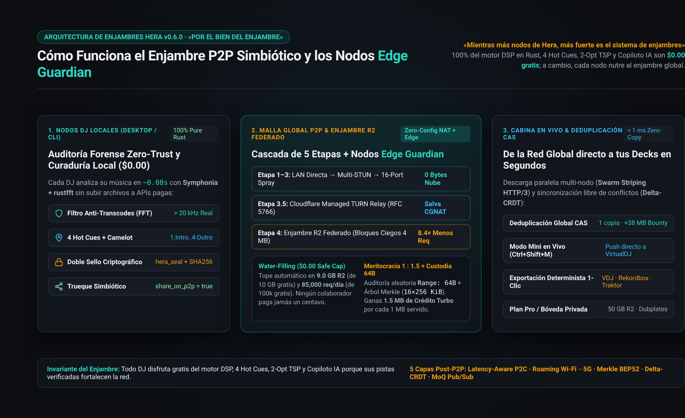
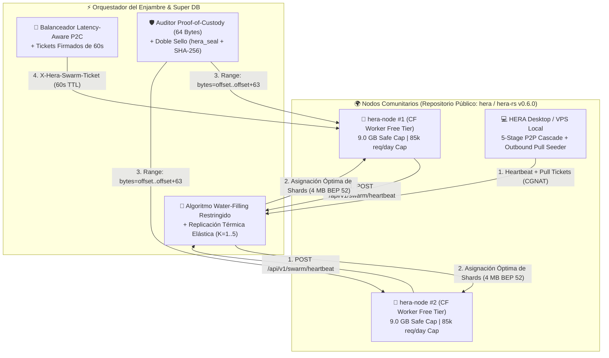

# 🐝 HERA Federated R2 Edge Swarm — Guía de Nodos Comunitarios & `Edge Guardians` (`v0.6.0`)

> **Lema del Enjambre:** *«Mientras más nodos de Hera, más fuerte es el sistema de enjambres»*  
> **Regla de Oro:** *«La mejor decisión es por el bien del enjambre siempre.»*  
> **Runtime:** `hera-node-rs v0.6.0` (`native` Desktop/VPS + `cloudflare` Workers WASM + R2 + D1 + Vectorize)



---

## 🎯 Visión General (Contexto del Repositorio Público `hera`)

En el ecosistema Open-Core de **HERA (`v0.6.0`)**, cualquier DJ o desarrollador de la comunidad puede ejecutar **HERA Desktop** o desplegar su propia instancia de [`hera-rs`](../hera-rs/README.md) sobre el **Plan Gratuito de Cloudflare Workers + R2 (`$0.00/mes`)** o en un micro-VPS/laptop local.

Cuando un nodo comunitario (`hera-node`) se une a la federación:
1. **Trueque Simbiótico (`100% Gratis` por Nutrir el Enjambre):** Todo el motor DSP en Rust (`Symphonia + rustfft`), los 4 Hot Cues acústicos, el optimizador global `2-Opt TSP`, los exportadores para VirtualDJ / Rekordbox / Traktor y `Cloudflare Workers AI Free` (`10,000 Neurons/día` a `$0.00`) son gratuitos. A cambio, todas las cuentas gratuitas/locales mantienen `share_on_p2p = true` por defecto.
2. **Capacidad Ociosa Segura (`Zero-Egress`):** Comparte automáticamente una fracción segura de su bucket gratuito de Cloudflare R2 (`10 GB/mes` gratis) y peticiones diarias (`100,000 req/día` gratis) para alojar fragmentos ofuscados (`Blind Shards`) de los masters más demandados de la red.
3. **El Enjambre Decide Matemáticamente (`Constrained Water-Filling`):** Ningún humano tiene que configurar límites manuales. El algoritmo de optimización **Water-Filling Restringido** calcula en cada heartbeat cuánto espacio y cuántas réplicas ($K$) asignar a cada nodo, respetando techos estrictos de seguridad (`9.0 GB` R2 y `85,000 req/día`) para que **ningún colaborador pague jamás un centavo a Cloudflare**.
4. **Meritocracia Automática (`Edge Guardian` + Créditos Turbo `1 : 1.5`):** Mientras el nodo comunitario está en línea y supera las auditorías automáticas de custodia de 64 bytes (`Proof-of-Custody`), el DJ recibe **acceso ilimitado al carril rápido (`EDGE_GUARDIAN_UNLIMITED_FAST_LANE`)** y además acumula **`1.5 MB` de Crédito Turbo por cada `1.0 MB` servido** a otros peers (`ProofOfDeliveryReceipt`).

---

## 🏗️ Arquitectura del Enjambre Federado (`hera-rs/src/p2p/` & `hera-rs/src/p2p_exchange.rs`)



---

## 🧮 1. Optimización Autónoma: `Constrained Water-Filling` + `Elastic K` + `P2C`

Implementado en [`hera-rs/src/p2p_exchange.rs`](../hera-rs/src/p2p_exchange.rs) y [`hera-rs/src/p2p/`](../hera-rs/src/p2p):

### A. Techos de Seguridad de Costo `$0.00` (Protección al Colaborador)
Para proteger el Free Tier de Cloudflare de cada miembro de la comunidad:
- **`CF_WORKER_SAFE_R2_CAP_MB = 9,000.0` (`9.0 GB`):** Deja `1.0 GB` de colchón libre debajo del límite gratuito de `10 GB` de Cloudflare R2.
- **`CF_WORKER_SAFE_REQ_CAP = 85,000` (`85,000 req/día`):** Deja `15,000 req/día` de colchón libre debajo de las `100,000 req/día` gratuitas de Cloudflare Workers. Si un nodo alcanza `85,000` peticiones en el día UTC, su margen efectivo se reduce automáticamente a `0` hasta el día siguiente.

### B. Nivelación Matemática (`compute_water_filling_allocations`)
1. Filtra únicamente los nodos activos y verificados (`edge_guardian_active == true && custody_status == "ONLINE_HEALTHY"`).
2. Ordena los nodos en orden ascendente de su espacio libre efectivo (`headroom`):
   $$\text{Headroom}_i = \max\left(0,\; \min(9000\text{ MB}, C_i) - U_i\right)$$
3. Calcula el nivel de llenado $\lambda$ óptimo para distribuir la demanda térmica (`total_hot_demand_mb`): los nodos más pequeños o más llenos llegan suavemente a su techo seguro (`9.0 GB`), y el excedente fluye automáticamente hacia los nodos con mayor capacidad disponible.

### C. Factor de Replicación Térmica Elástica ($K$)
[`compute_elastic_replication_factor`](../hera-rs/src/p2p_exchange.rs) escala el número de réplicas de cada pista según el tamaño del enjambre ($N$ nodos saludables) y el calor de la pista (`heat_score`):
- $N = 0 \implies K = 1$
- $N \in [1, 4] \implies K = 2$ (o $K = 3$ si `heat_score >= 3.0`)
- $N \ge 5 \implies K = 3 \dots 5$ para pistas calientes (`heat_score >= 5.0`), multiplicando el caudal de descarga global sin desperdiciar megabytes en canciones frías.

### D. Enrutamiento `Power-of-Two-Choices (P2C)` (`select_node_p2c`)
Cuando un DJ solicita descargar un bloque (`4 MB`), el enjambre selecciona determinísticamente dos nodos saludables que poseen ese shard y elige el nodo con **menor costo compuesto de peticiones y latencia (`ewma_rtt_ms`)**, evitando cuellos de botella en tiempo $O(1)$.

---

## 🛡️ 2. Privacidad, Seguridad Zero-Trust y Eficiencia Edge (`8.4x`)

1. **Ofuscación Ciega de Catálogo (`Blind Catalog Sharding`):**
   - Los nodos comunitarios **nunca almacenan nombres de artistas ni títulos en claro** dentro de sus buckets R2.
   - [`derive_blind_shard_key`](../hera-rs/src/p2p_exchange.rs) genera llaves opacas mediante HMAC: `shard-blobs/{hmac}.hbin`.
2. **Tickets Firmados de `60s` (`X-Hera-Swarm-Ticket`):**
   - Ningún bot externo puede hacer *hotlinking* o escanear el bucket de un colaborador.
   - `GET /api/v1/swarm/shard/:blob_id` exige un [`SwarmRedirectTicket`](../hera-rs/src/p2p_exchange.rs) firmado con HMAC-SHA256, `TTL <= 60s` y `nonce` único de un solo uso.
3. **Bloques Alineados de `4 MB` (`8.4x` Multiplicador de Peticiones):**
   - `SWARM_BLOCK_SIZE_BYTES = 4,194,304` (`4 MB`) servidos con `Cache-Control: public, max-age=31536000, immutable`.
   - Reduce la descarga de un FLAC de `38 MB` de ~84 invocaciones de Worker a solo ~10 invocaciones, permitiendo servir **8.4 veces más pistas** dentro del mismo Free Tier.
4. **Auditoría `Proof-of-Custody` de 64 Bytes (`issue_custody_challenge` / `verify_custody_response`):**
   - El enjambre envía desafíos aleatorios de rango (`Range: bytes=offset..offset+63`) contra los shards alojados en el R2 del nodo.
   - Si el nodo devuelve `404` o un hash incorrecto, pierde inmediatamente el estatus `Edge Guardian` y sale del balanceador `P2C`.
5. **Doble Sello Criptográfico Anti-Poisoning (`hera_seal` + `audio_sha256`):**
   - Protege contra ataques *Bait-and-Switch* (pasar la auditoría acústica FFT con un FLAC real pero subir ruido corrupto al shard).
   - Si `audit_and_quarantine_poisoned_shard` detecta discrepancia en cualquiera de los dos sellos, el nodo es aislado en `quarantined_nodes`.

---

## 🔌 3. Referencia de Endpoints del Enjambre (`hera-rs`)

Todos los nodos `hera-node-rs` exponen los siguientes endpoints del enjambre en [`hera-rs/src/router.rs`](../hera-rs/src/router.rs):

| Método | Ruta | Descripción |
| :--- | :--- | :--- |
| `GET` | `/api/v1/swarm/strength` | Devuelve las métricas en vivo del enjambre (`SwarmStrengthMetrics`), número de `Edge Guardians`, capacidad R2 agregada, factor $K$ y el lema oficial. |
| `POST` | `/api/v1/swarm/heartbeat` | Registra el estado del nodo comunitario, ejecuta `Constrained Water-Filling`, actualiza el estatus `Edge Guardian` y devuelve `outbound_pull_tickets` (soporte CGNAT). |
| `POST` | `/api/v1/swarm/route-ticket` | Selecciona el mejor nodo vía `P2C`, emite el `SwarmRedirectTicket` (`60s` TTL) y acredita el multiplicador `1 : 1.5` (`ProofOfDeliveryReceipt`). |
| `GET` | `/api/v1/swarm/shard/:blob_id` | Sirve un bloque inmutable de `4 MB` desde el bucket R2 (`HERA_R2_VAULT`) tras validar el header `X-Hera-Swarm-Ticket`. |
| `POST` | `/api/v1/swarm/custody-challenge` | Genera un desafío `Proof-of-Custody` aleatorio de 64 bytes para auditar un shard en R2. |
| `GET` | `/api/v1/swarm/custody-probe/:blob_id` | Lee directamente los 64 bytes solicitados desde el bucket R2 del nodo y devuelve su firma SHA-256/FNV-1a. |
| `POST` | `/api/v1/swarm/custody-audit` | Verifica la respuesta del desafío de 64 bytes y mantiene o revoca el privilegio `Edge Guardian`. |
| `GET` | `/api/v1/swarm/quarantine` | Lista los `node_id` aislados en cuarentena por fallos de integridad o intentos de *Bait-and-Switch*. |
| `POST` | `/api/v1/swarm/parallel-manifest` | Emite un manifiesto `HTTP/3-QUIC-MULTIPLEXED` multi-nodo (`Swarm Striping`) usando `Latency-Aware P2C` para descargar los bloques de `4 MB` en paralelo desde múltiples `Edge Guardians`. |
| `POST` | `/api/v1/swarm/crdt-sync` | Sincroniza estado *Offline-First* mediante `Delta-CRDT` (`GCounter` + `LWW-Element-Set`) con convergencia conmutativa, asociativa e idempotente (`merge(A, B) == merge(B, A)`). |
| `POST` | `/api/v1/swarm/subscribe` | Suscribe un nodo a un tópico semántico armónico estilo `MoQ` (`hera://swarm/<camelot>/<bpm_min>-<bpm_max>`) y empuja eventos proactivos en cada heartbeat. |

---

## ⚡ 4. Evolución Post-P2P de 5 Capas (Iroh / BitTorrent v2 BEP 52 / HTTP/3 QUIC / Delta-CRDT / MoQ)

1. **Capa 3 — Streaming Merkle Proofs (`16 x 256 KiB = 4 MB` estilo BitTorrent v2 BEP 52 / Iroh):**
   - Cada shard alineado de `4 MB` construye un árbol de Merkle binario SHA-256 de 16 hojas (`256 KiB` por hoja) con pruebas de inclusión compactas de 4 hermanos (`X-Hera-Merkle-Root` y `X-Hera-Merkle-Proof`), permitiendo verificar la autenticidad en el primer kilobyte y abortar al instante cualquier byte corrupto.
2. **Capa 2 — Identidad Criptográfica (`endpoint_pubkey_id`) + Roaming `Wi-Fi -> 5G` + CGNAT Relay:**
   - Los nodos se anclan a un `endpoint_pubkey_id` (`ed25519_<hex>`) persistente. Si un DJ cambia de IP/red en cabina (`Wi-Fi -> 5G`), `network_generation` se incrementa sin perder estatus `Edge Guardian` ni créditos (`1 : 1.5`), activando `relay_assisted_url` (`https://relay.hera.audio/iroh-tunnel/<pubkey>`) tras CGNAT.
3. **Capa 1 y 2 — `Latency-Aware P2C` + `Swarm Striping` Multi-Nodo (`POST /api/v1/swarm/parallel-manifest`):**
   - Pondera la carga diaria de peticiones junto con la latencia `ewma_rtt_ms` (`compute_node_p2c_composite_cost`) y distribuye los 10 bloques de `4 MB` de un FLAC de `38 MB` entre múltiples Workers saludables simultáneamente.
4. **Capa 4 — Sincronización `Delta-CRDT` Libre de Conflictos (`POST /api/v1/swarm/crdt-sync`):**
   - Combina un `GCounter` monotónico para megabytes servidos y conteo de reproducciones con un `LWW-Element-Set` gobernado por *Hybrid Logical Clock* (`hlc_timestamp_ms`) para metadatos y Hot Cues.
5. **Capa 5 — Pub/Sub Semántico Armónico estilo `MoQ` (`POST /api/v1/swarm/subscribe`):**
   - Permite suscribirse a `hera://swarm/<camelot>/<bpm_min>-<bpm_max>` (incluyendo quintas adyacentes y relativos en la rueda de Camelot) y recibir eventos con `style_simhash_u64` y `merkle_root_sha256` en el mismo ciclo de heartbeat.

---

## 🚀 5. Cómo Desplegar tu Propio Nodo `Edge Guardian` en Cloudflare Workers (`$0.00/mes`)

```bash
# 1. Entra al motor Rust de Hera
cd hera-rs

# 2. Verifica compilación y suite de tests del enjambre
cargo test

# 3. Autentícate en Cloudflare y despliega tu Worker + R2 Bucket
npx wrangler login
npx wrangler deploy
```

Una vez desplegado, verifica que tu nodo responde al estado del enjambre:

```bash
curl -s https://tu-hera-node.workers.dev/api/v1/swarm/strength | jq .
```
