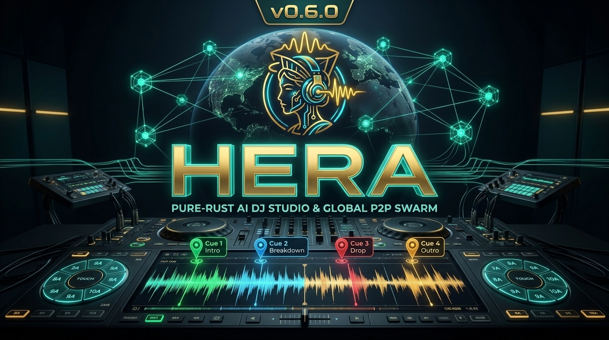
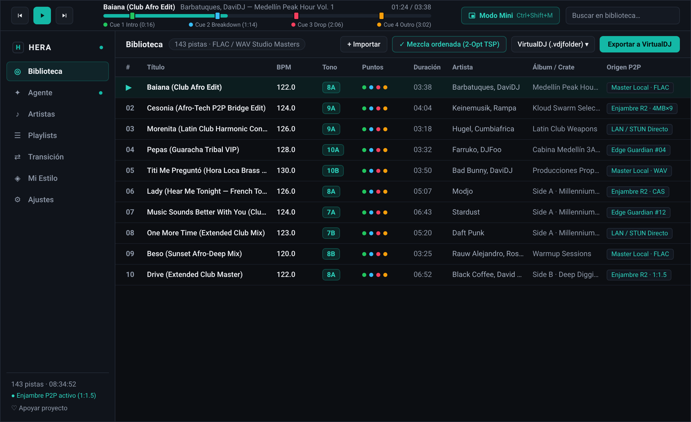
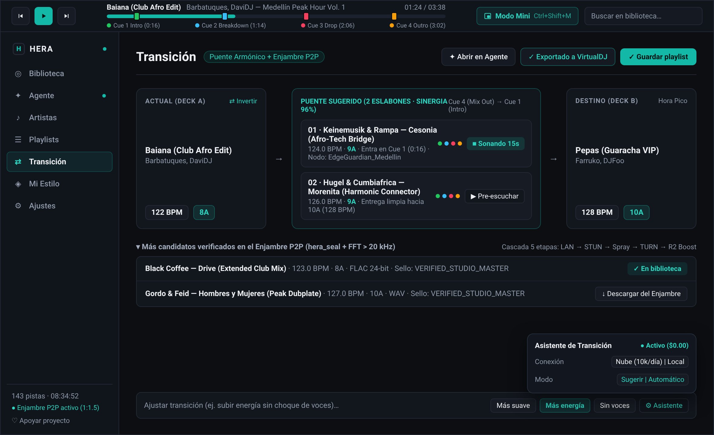
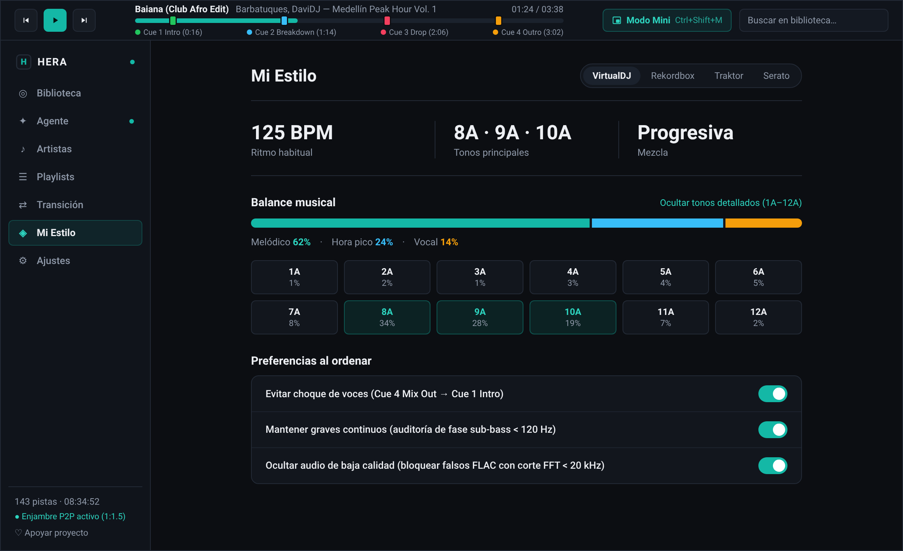
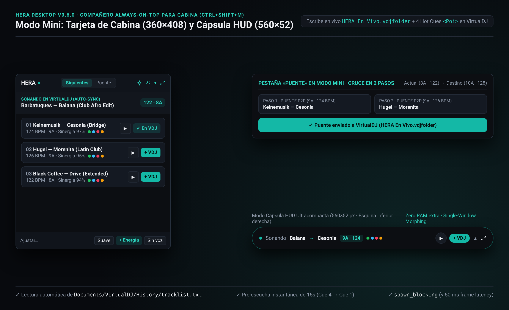
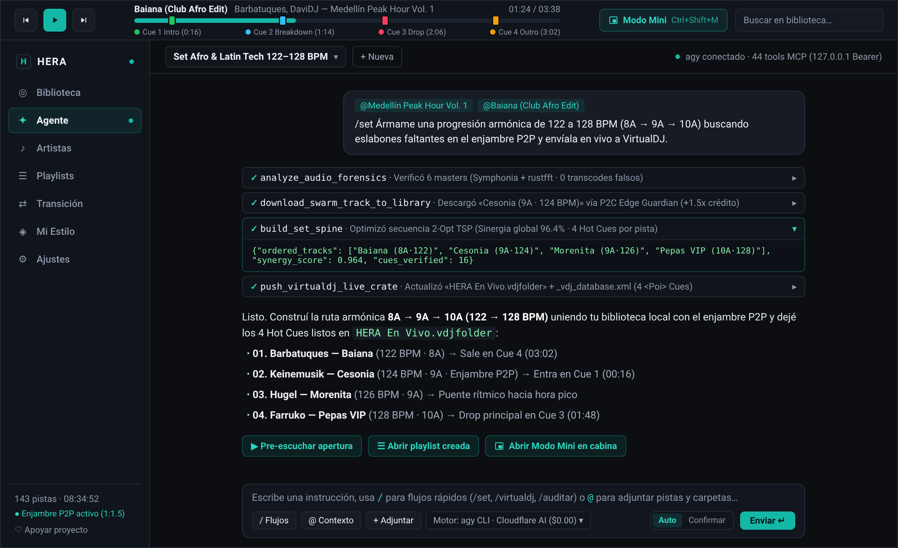

# 🎧 Guía Completa de Modos de Uso de HERA (`v0.6.0`)
### *«Elige tu forma favorita de crear y mezclar música: desde el Dark Booth Studio nativo hasta el Enjambre P2P y super-agentes autónomos»*



HERA (`v0.6.0` — **100% Pure Rust + Tauri v2**, `~8 MB` nativo, cero Python) está diseñada para adaptarse a cualquier cabina de DJ o flujo de producción. Aquí tienes los **5 modos de uso**, acompañados de capturas reales de cada pantalla y del concepto del **Enjambre P2P Simbiótico**.

---

## 🗺️ Tabla Comparativa de Métodos (`v0.6.0`)

| Método | Nivel | ¿Qué necesitas? | ¿Cómo se siente? |
| :--- | :---: | :--- | :--- |
| **1. HERA Desktop (`Dark Booth Studio`)** | ⭐ (Directo) | App nativa Tauri v2 (`~8 MB`) | Estudio de cabina oscuro con 4 Hot Cues, `2-Opt TSP`, `Transición` y `Mi Estilo` |
| **2. `Modo Mini` Always-on-Top (`Ctrl+Shift+M`)** | ⭐ (En Vivo) | HERA Desktop + VirtualDJ / Serato | Tarjeta flotante (`360×408`) o cápsula HUD (`560×52`) sobre tus decks en vivo |
| **3. Espacio `/agent` Integrado (`Ctrl+J`)** | ⭐ (Copiloto IA) | Pestaña `Agente` en HERA Desktop | Copiloto con 44 tools MCP, menciones `@ Contexto`, `/set` y compuerta `Confirmar` |
| **4. Servidor MCP Puro en Rust (`stdio` / `HTTP`)** | ⭐⭐ (Agentes CLI) | `hera-node --mcp` + Antigravity / Claude / Cursor | 21 herramientas DSP, `2-Opt TSP` y Enjambre P2P conectadas a tu CLI favorito |
| **5. Nodo `Edge Guardian` & Super-Nodo 24/7** | ⭐⭐ (`$0.00` Edge / VPS) | Cloudflare Workers Free o Micro-VPS (`~10 MB RAM`) | Tu propio nodo del enjambre sirviendo bloques Merkle de `4 MB` y ganando créditos `1:1.5` |

---

## 🖥️ Modo 1: HERA Desktop — Dark Booth Studio (`/library`, `/bridge`, `/dna`)
*Ideal para: DJs de club, residentes y productores que quieren auditar su colección en Rust (`Symphonia + rustfft`), clavar 4 Hot Cues automáticos, armar puentes armónicos y exportar a VirtualDJ, Rekordbox o Traktor en 1 clic.*

### 1.1 Biblioteca DJ, 4 Hot Cues y Curaduría `2-Opt TSP` (`/library`)


1. **Importación y Auditoría Forense (`< 80 ms` por pista):** Importa cualquier carpeta (`WAV`, `FLAC`, `MP3`, `M4A`, `AAC`, `ALAC`, `OGG`, `AIFF`). HERA detecta falsos lossless (`rustfft`), verifica correlación de fase sub-grave (`< 120 Hz`) y calcula BPM y llave Camelot (`1A`–`12B`).
2. **4 Pines de Hot Cues Interactivos:** Salta en 1 clic en la barra superior a **`🟢 1 Intro`**, **`🔵 2 Breakdown`**, **`🔴 3 Drop`** y **`🟡 4 Outro`**.
3. **Ordenar Mezcla (`2-Opt TSP`) y Exportar:** Ordena la sesión entera minimizando saltos armónicos y de energía, y exporta con todos los cues a **VirtualDJ (`.vdjfolder`)**, **Rekordbox (`.xml`)**, **Traktor (`.nml`)** o **M3U8**.

### 1.2 Estudio de Transición y Puente Armónico con Enjambre P2P (`/bridge`)


- Conecta dos pistas alejadas en BPM y tonalidad (`Actual → Puente sugerido → Destino`) encontrando los eslabones intermedios exactos tanto en tu biblioteca local como en el **Enjambre P2P**.
- Pre-escucha 15 segundos del cruce (`Cue 4 Mix Out → Cue 1 Intro`) con el motor `DualDeckEngine` (`#![forbid(unsafe_code)]`) y ajusta la transición (`Más suave`, `Más energía`, `Sin voces`).

### 1.3 Mi Estilo y ADN Musical (`/dna`)


- Sintetiza tu firma acústica (`SimHash u64`, BPM habitual, tonos principales Camelot y balance `Melódico · Hora pico · Vocal`) sin depender de Internet y configura tus preferencias al ordenar sets.

---

## ⧉ Modo 2: `Modo Mini` Always-on-Top para Cabina en Vivo (`Ctrl+Shift+M`)
*Ideal para: Mezclar en vivo en una sola pantalla de laptop con VirtualDJ sin tapar las formas de onda ni los decks.*



Al pulsar **`Ctrl+Shift+M`** (o el botón **`Modo Mini`** en la cabecera), la ventana de HERA se transforma sin usar memoria extra en dos formatos flotantes (`alwaysOnTop = true`):
- **Tarjeta de Cabina (`360×408 px`):** Lee en tiempo real qué canción está sonando en VirtualDJ (`History/tracklist.txt`), muestra las 3 siguientes pistas compatibles (o un puente armónico en 2 pasos) y al pulsar **`+ VDJ`** inyecta la pista con sus 4 Hot Cues `<Poi>` directo en `Documents/VirtualDJ/Folders/HERA En Vivo.vdjfolder`.
- **Cápsula HUD (`560×52 px`):** Barra ultracompacta de una sola línea (`Sonando → Siguiente · Tono · BPM · 4 Cues · [+ VDJ]`).

---

## ✨ Modo 3: Espacio `/agent` Autónomo con 44 Herramientas MCP (`Ctrl+J`)
*Ideal para: Pedir sets completos, auditar carpetas o descubrir puentes en el enjambre P2P conversando en lenguaje natural dentro de la app.*



1. Pulsa **`Ctrl+J`** o abre la pestaña **`Agente`**.
2. Adjunta pistas, playlists o carpetas con **`@ Contexto`** o usa comandos rápidos (`/set`, `/virtualdj`, `/importar`, `/auditar`).
3. Elige entre **`Cloudflare Workers AI Free ($0.00 — 10,000 Neurons/día)`**, agentes CLI locales (`agy`, `claude`, `gemini`, `codex`) o servidores locales (`Ollama`, `LM Studio`, `Llama.cpp`).
4. Supervisa cada herramienta ejecutada en filas colapsables de `28 px` con política **`Auto`** o **`Confirmar`** antes de modificar archivos.

---

## 🔌 Modo 4: Servidor MCP Nativo en Rust (`hera-node --mcp`)
*Ideal para: Desarrolladores y DJs que usan Antigravity CLI (`agy`), Claude Desktop, Cursor o Codex desde su terminal.*

### 🚀 Cómo iniciarlo:
```bash
cargo run --release -p hera-node-rs -- --mcp
```

Configuración en tu cliente MCP (`mcp_config.json`):
```json
{
  "mcpServers": {
    "hera": {
      "command": "cargo",
      "args": ["run", "--release", "-p", "hera-node-rs", "--", "--mcp"]
    }
  }
}
```

Tendrás acceso inmediato a las **21 herramientas nativas de `hera-node-rs`** (`analyze_audio_forensics`, `build_dj_crate`, `build_set_spine`, `export_dj_crate`, `compute_dj_style_dna`, `get_swarm_strength`, `swarm_route_ticket`, etc.) además de `Code Mode` (`POST /mcp/code-mode`).

---

## 🐝 Modo 5: Enjambre P2P Simbiótico & Nodo `Edge Guardian` (`$0.00/mes`)
*Ideal para: Nutrir y aprovechar la red global de Masters Lossless verificados («Mientras más nodos de Hera, más fuerte es el sistema de enjambres»).*


1. **Trueque Simbiótico (`Por el bien del enjambre`):** Todo el software, DSP, 4 Hot Cues y IA de HERA es `$0.00` gratis; a cambio, los nodos gratuitos mantienen activo el P2P (`share_on_p2p = true`) compartiendo únicamente Masters verificados (`VERIFIED_STUDIO_MASTER` con doble sello `hera_seal` + `audio_sha256`).
2. **Despliega tu Nodo `Edge Guardian` en Cloudflare Workers (`$0.00/mes`):**
   ```bash
   cd hera-rs
   npx wrangler deploy
   ```
   El algoritmo **Constrained Water-Filling** protege matemáticamente tu cuenta gratuita (`9.0 GB` R2 máx. y `85,000 req/día` máx.) mientras ganas **`1.5 MB` de Crédito Turbo por cada `1.0 MB` servido** (`ProofOfDeliveryReceipt`). Consulta la [Guía del Enjambre R2 Federado](FEDERATED_R2_SWARM.md) y la [Guía de VPS Remoto](VPS_REMOTE_GUIDE.md).
