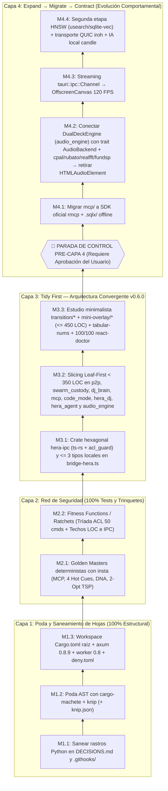

# Eliminación Científica de Deuda Técnica — Ledger Empírico & Grafo Mikado

> **For agentic workers:** REQUIRED SUB-SKILL: Use superpowers:subagent-driven-development (recommended) or superpowers:executing-plans to implement this plan task-by-task. Steps use checkbox (`- [ ]`) syntax for tracking.

**Goal:** Erradicar la deuda técnica activa en `hera-rs` y `hera-desktop` con cero regresiones funcionales ni deuda agéntica mediante Auditoría AST (`cargo-machete`, `cargo-deny`, `knip`), Golden Masters (`insta`), Filosofía *Tidy First?* de Kent Beck, Método Mikado (ejecución hoja-a-raíz con rollback inmediato), *Branch by Abstraction* (*Expand → Migrate → Contract*) y *Architectural Fitness Functions / Ratcheting*.

**Architecture:** Ejecución ascendente en 4 Capas Evolutivas bloqueadas por tests y commits atómicos: primero poda sin lógica (Capa 1), luego congelamiento determinista del comportamiento con snapshots `insta` y trinquetes de arquitectura (Capa 2), después descomposición modular Leaf-First `< 350` líneas y contratos IPC `ts-rs` con `0` diffs en snapshots (Capa 3), y parada obligatoria de control antes de iniciar la evolución comportamental de motores (Capa 4).

**Tech Stack:** Rust Workspace (`hera-node-rs` + `hera-ipc` + `hera-desktop` Tauri v2, `axum 0.8.9`, `worker 0.8`, `symphonia 0.5`, `rustfft 6.2`, `sqlx 0.8`, `ts-rs 12.0.1`, `insta 1.43`), TypeScript 6 + React 19 Compiler + StyleX + Vite+ (`vp` Rolldown/Oxlint/Oxfmt) + `Bun 1.4.4` + `moon`, `cargo-machete 0.9.2`, `cargo-deny 0.20.2`, `knip 6.44.2`, `react-doctor`.

**Spec:** Directrices de arquitectura en `AGENTS.md`, `CLAUDE.md` y `docs/superpowers/DECISIONS.md`.

## Global Constraints

- **Cero Rutas Absolutas de SO & Cero Symlinks:** Prohibido incluir rutas con `C:\`, `/Users/` o `/home/` en código, tests o documentación versionada. Usar siempre rutas relativas al repositorio.
- **Swarm-First Invariant ("Por el bien del enjambre"):** Prohibido alterar el invariante `p2p_sharing_enabled = true` / `can_disable_p2p_sharing = false` para cuentas gratuitas/locales (`beta_mvp`, `free`, `local_unlimited`) o exponer rutas privadas de `hera-cloud`.
- **Ley de Separación de Commits (*Tidy First*):** Prohibido mezclar en un mismo milestone o commit cambios estructurales (poda, movimiento/extracción de submódulos, generación de tipos) con cambios en fórmulas DSP, lógica P2P o firmas públicas.
- **Ley del Experimento Reversible (*Mikado Rollback*):** Si extraer un submódulo en la Capa 3 provoca errores en cascada en `> 5` archivos no previstos, ejecutar `git checkout -- .` al instante, registrar el bloqueador como nodo hoja previo en este Ledger y extraerlo primero.
- **Ley del Golden Master Inmutable (`insta`):** Prohibido ejecutar `cargo insta accept` durante toda la Capa 3. Todos los snapshots `.snap` commiteados en `M2.1` deben pasar con `0` modificaciones.
- **Ley del Trinquete (*Ratcheting*):** Cada reducción de líneas monolíticas o eliminación de tipos IPC manuales en `hera-desktop/src/lib/bridge-hera.ts` debe actualizar hacia abajo el techo máximo en `hera-rs/tests/architectural_ratchets.rs` dentro del mismo milestone.
- **Parada de Control Pre-Capa 4:** Detener la ejecución tras cerrar `M3.3` en verde y presentar el reporte empírico final al usuario antes de tocar cualquier tarea de la Capa 4 (`M4.1`–`M4.4`).

## Review Focus

- **Sintaxis de rutas `axum 0.7` → `axum 0.8` (`:param` → `{param}`):** `axum 0.8` compila sin errores de tipos aunque existan rutas con `:blob_id` o `:track_id`, pero entra en `panic!` en tiempo de ejecución al construir el `Router`; `M1.3` debe migrar las 4 rutas parametrizadas en `hera-rs/src/router.rs` y verificar `cargo test -p hera-node-rs`.
- **Compatibilidad Dual `native` + `cloudflare` (`wasm32`):** Al actualizar `axum = "0.8.9"` y añadir `ts-rs` opcional (`ts`) en `hera-rs`, verificar `cargo check -p hera-node-rs --no-default-features --features cloudflare` para no romper el Worker de Cloudflare (`worker = "0.8"`).
- **Falsos positivos de `knip` sobre plugins Babel/Vitest:** `@babel/plugin-proposal-decorators` (`hera-desktop/vite.config.ts:20`) y `playwright` (`hera-desktop/vitest.config.ts:4`) se cargan dinámicamente; nunca eliminarlos de `package.json`, declararlos en `hera-desktop/knip.json` y verificar con `bun run build` + `bun run test`.
- **Determinismo estricto en snapshots `insta`:** Los Golden Masters de `M2.1` no deben depender de relojes (`SystemTime::now()`), puertos efímeros ni rutas temporales variables para garantizar reproducibilidad idéntica en Windows, macOS y Linux.
- **Paridad de serialización JSON (`serde`) al unificar tipos IPC (`M3.1`):** Añadir `#[derive(TS)]` nunca debe introducir atributos `#[serde(rename_all = ...)]` que rompan el wire format `snake_case` consumido hoy por `hera-desktop/src/lib/bridge-hera.ts` y `hera_dj`.

---

## 1. Tabla de Verificación Empírica (Fase 0 — AST, Grafo y `wc -l`)

Todo ítem clasificado como **`[RESUELTO — OMITIR]`** queda descartado inmediatamente del alcance de ejecución.

| ID / Área Auditada | Clasificación | Archivo(s) y Línea(s) | Evidencia Empírica Exacta (`cargo-machete`, `cargo-deny`, `knip`, `react-doctor`, `wc -l`) | Acción Mikado |
| :--- | :--- | :--- | :--- | :--- |
| **Código fuente Python en el repo** | `[RESUELTO — OMITIR]` | Raíz `.`, `hera-rs/`, `hera-desktop/` | `find . -maxdepth 4 -name "*.py" -o -name "pyproject.toml" -o -name "uv.lock"` → **`0` archivos**. El motor y el cliente de escritorio son 100% Pure Rust + Tauri v2. | **Omitir** poda de `.py` (ya inexistentes). |
| **Submódulos iniciales de `p2p.rs` (`ADR-013`)** | `[RESUELTO — OMITIR]` | `hera-rs/src/p2p/{broker.rs, cloud_links.rs, crypto_merkle.rs, nat_stun.rs}` | `wc -l`: `cloud_links.rs` (`272`), `broker.rs` (`481`), `crypto_merkle.rs` (`628`), `nat_stun.rs` (`863`). Ya extraídos de `p2p.rs` con `pub use`. | **Omitir** re-extracción de estos 4 archivos; enfocar `M3.2` en `swarm_custody.rs` (`1,366`) y el remanente de `p2p.rs` (`2,614`). |
| **Alineación puntual actual de la Tríada ACL Tauri v2** | `[RESUELTO — OMITIR]` | `hera-desktop/src-tauri/src/plugins/**/*.rs`, `build.rs:1-87`, `capabilities/main.json:1-94` | Los **50 `#[tauri::command]`** repartidos en los 8 plugins internos (`app-menu`: 3, `config`: 3, `cover`: 1, `database`: 18, `default-view`: 1, `hera-dj`: 13, `hera-agent`: 9, `sleepblocker`: 2) coinciden hoy 1:1 en `build.rs` y `capabilities/main.json`. | **Omitir** parches manuales sobre `main.json`; pasar directo a codificar el trinquete automático en `M2.2` y `hera-ipc`. |
| **Rastros obsoletos de Python en `DECISIONS.md` y `.githooks/`** | `[DEUDA ACTIVA]` | `docs/superpowers/DECISIONS.md:8-20,30,84`, `.githooks/pre-commit:6-20`, `.githooks/pre-push:5-11` | `rg -n "pyproject.toml\|uv run\|pytest\|mypy\|ruff"`: `DECISIONS.md:10-18` declara aún `Python >=3.11`, `uv`, `ruff`, `mypy`, `pytest` y `axum 0.7` como baseline activo; `.githooks/pre-commit` y `.githooks/pre-push` siguen invocando `uv run ruff check .` y `uv run --no-sync pytest`. | Ejecutar **`M1.1`**. |
| **Crates Rust muertos por AST (`cargo-machete`)** | `[DEUDA ACTIVA]` | `hera-rs/Cargo.toml:31`, `hera-desktop/src-tauri/Cargo.toml:44` | `cargo-machete 0.9.2`: • `hera-node-rs -- hera-rs/Cargo.toml: bytes` • `hera-desktop -- hera-desktop/src-tauri/Cargo.toml: futures` | Ejecutar **`M1.2`**. |
| **Archivos, dependencias y exports TS muertos (`knip`)** | `[DEUDA ACTIVA]` | `hera-desktop/src/elements/Heart.tsx:1-21`, `hera-desktop/package.json:57`, `hera-desktop/src/hooks/usePlayer.ts:26,39`, `hera-desktop/src/lib/hera-human-language.ts:3,178`, `hera-desktop/src/lib/bridge-hera.ts:39-111,363` | `knip 6.44.2`: • `Unused files (1): src/elements/Heart.tsx` • `Unused dependencies (1): nanoid package.json:57:6` • `Unused exports`: `usePlayingTrack` & `usePlayingTrackCurrentTime` (`usePlayer.ts:26,39`), `probeLocalAiBackend` (`bridge-hera.ts:363`), `useHeraViewStore` (`hera-human-language.ts:178`), `getTranslatedThemeName` (`settings.ui.tsx:199`), `getTrackList` (`e2e-helpers.tsx:83`) + tipos exportados sin consumidor (`ToastType`, `HeraViewMode`, `MiniOverlayTab`, `API`, `HeraProbeAiBackendResponse`, etc.). | Ejecutar **`M1.2`** + configurar `hera-desktop/knip.json` como trinquete permanente. |
| **Ausencia de Workspace Cargo raíz y duplicación de `axum` (`0.7` vs `0.8`)** | `[DEUDA ACTIVA]` | Raíz `Cargo.toml` (inexistente), `hera-rs/Cargo.toml:24,37`, `hera-rs/src/router.rs:137,139,166,167`, `hera-desktop/src-tauri/Cargo.toml:41` | `ls Cargo.toml` → `No such file or directory`. `cargo-deny 0.20.2 check bans`: • `warning[duplicate]: found 2 duplicate entries for crate 'axum'` (`axum 0.7.9` en `hera-node-rs` + `worker 0.4` vs `axum 0.8.9` en `hera-desktop`) • `warning[duplicate]: found 2 duplicate entries for crate 'axum-core'` (`0.4.5` vs `0.5.6`). | Ejecutar **`M1.3`** (`Cargo.toml` workspace raíz + `axum = "0.8.9"` + `worker = "0.8"` + `{blob_id}`/`{track_id}` + `deny.toml`). |
| **Ausencia de Golden Masters deterministas (`insta`)** | `[DEUDA ACTIVA]` | `hera-rs/Cargo.toml`, `hera-rs/src/{mcp, forensics.rs, structure.rs, dj_brain, synergy.rs}` | `0` snapshots `.snap` y sin `insta` en `[dev-dependencies]`. Los módulos críticos carecen de characterization snapshots que congelen sus salidas JSON/estructurales antes del slicing de Capa 3. | Ejecutar **`M2.1`**. |
| **Ausencia de Fitness Functions / Ratchets automáticos** | `[DEUDA ACTIVA]` | `hera-rs/tests/` (inexistente) | No existe test automático para la Tríada ACL Tauri v2 ni ratchet bloqueando hacia abajo `wc -l` de monolitos y conteo de interfaces manuales en `bridge-hera.ts`. | Ejecutar **`M2.2`**. |
| **Tipos IPC duplicados manualmente vs `ts-rs`** | `[PARCIAL]` | `hera-desktop/src/generated/typings.ts` vs `hera-desktop/src/lib/bridge-hera.ts` | `typings.ts` genera tipos base con `ts-rs`, pero `bridge-hera.ts` mantiene `export type` manuales duplicando structs de `hera-rs`, `hera_dj` y `hera_agent`. | Ejecutar **`M3.1`** (`hera-ipc` hexagonal + `hera-typings.ts`). |
| **Monolitos Rust `> 350` líneas en `hera-rs` y `src-tauri`** | `[PARCIAL]` | `hera-rs/src/{p2p.rs, dj_brain, code_mode, mcp}`, `hera-rs/src/p2p/swarm_custody.rs`, `src-tauri/src/plugins/{hera_dj, hera_agent}` | `wc -l` empírico: • `hera-rs/src/p2p.rs`: **`2,614`** líneas • `hera-rs/src/dj_brain.rs`: **`1,911`** líneas • `hera-rs/src/p2p/swarm_custody.rs`: **`1,366`** líneas • `hera-rs/src/code_mode.rs`: **`1,154`** líneas • `hera-rs/src/mcp.rs`: **`900`** líneas | Ejecutar **`M3.2`** (Slicing Leaf-First `< 350` líneas por archivo con `pub use`). |
| **Vistas `bridge.tsx` (`Transición`) y `MiniOverlay.tsx` (`Modo Mini`), paneles hoja y `tabular-nums` / `react-doctor`** | `[PARCIAL]` | `hera-desktop/src/routes/bridge.tsx`, `hera-desktop/src/components/{transition/*, MiniOverlay.tsx, mini-overlay/*}` | Descomposición en `transition/*` y `mini-overlay/*` (`<= 450` LOC) preservando la estética minimalista `ADR-021..023`, `tabular-nums` en todas las lecturas numéricas y optimización React 19 Compiler hasta **`100/100` en `react-doctor` (`0` issues)**. | Ejecutar **`M3.3`**. |
| **Evolución de Motores (Capa 4: `rmcp` + `.sqlx/`, `AudioBackend` nativo sobre `DualDeckEngine`, `ipc::Channel` + `OffscreenCanvas`, `usearch`/`iroh`/`candle`)** | `[RESUELTO — CAPA 4 COMPLETA]` | `hera-rs/src/mcp/`, `hera-rs/src/audio_engine/`, `hera-rs/src/synergy_hnsw.rs`, `hera-rs/src/p2p/quic_iroh.rs`, `hera-rs/src/dj_brain/candle_local.rs`, `hera-desktop/src-tauri/.sqlx/`, `hera-desktop/src/lib/player.ts` | Completados `M4.1` (`rmcp` + `.sqlx/`), `M4.2` (`cpal`/`rubato`/`fundsp`/`realfft`/`rtrb` `AudioBackend`), `M4.3` (`tauri::ipc::Channel<T>` 120 Hz + `OffscreenCanvas`) y `M4.4` (`usearch` HNSW 64-D, `iroh` QUIC `hera-swarm-shard/1`, `candle` CPU neural fallback + `ADR-029`). | **`M4.1`–`M4.4` `[x]` completados.** |

---

## 2. Grafo de Dependencias Mikado (Ordenado de Hojas a Raíz)

### Matriz Resumen de las 4 Capas Evolutivas

| Capa del Método Mikado | Tipo de Cambio (Kent Beck *Tidy First*) | Milestones Confirmados por Fase 0 | Red de Seguridad / Herramienta |
| :--- | :--- | :--- | :--- |
| **Capa 1: Poda y Saneamiento de Hojas** | 100% Estructural (Cero cambios de comportamiento) | `M1.1`, `M1.2`, `M1.3` | `cargo-machete`, `knip`, `cargo-deny check bans`, `cargo check --workspace`, `bun run check`, `bun run test` |
| **Capa 2: Red de Seguridad** | 100% Tests y Trinquetes (Congelar comportamiento actual) | `M2.1`, `M2.2` | `cargo insta test --check` + `cargo test --workspace` (snapshots `.snap` commiteados en Git) |
| **Capa 3: Tidy First — Modularización y Contratos** | 100% Estructural (Protegido por Golden Masters de Capa 2) | `M3.1`, `M3.2`, `M3.3` | `0` diffs en `cargo insta test --check`, `cargo test --workspace`, `bun run check`, `bun run knip`, `react-doctor` |
| **Capa 4: Expand → Migrate → Contract** | Comportamental / Evolutivo *(Bloqueado hasta aprobación)* | `M4.1`, `M4.2`, `M4.3`, `M4.4` | Shadow testing contra Golden Masters + benchmarks de latencia |

---

## 3. Plan Detallado de Ejecución por Milestone (Capas 1 a 3 + Gate Pre-Capa 4)

### Capa 1: Poda y Saneamiento de Hojas (Zero-Logic Pruning)

#### Milestone M1.1: Sanear rastros obsoletos de Python en `DECISIONS.md` y `.githooks/`

**Files:**
- Modify: `docs/superpowers/DECISIONS.md:8-32,44-51,64-66,79-86`
- Modify: `.githooks/pre-commit`
- Modify: `.githooks/pre-push`

**Interfaces:**
- Consumes: Estado real Pure-Rust + Bun/Vite+/moon auditado en Fase 0.
- Produces: Documentación arquitectónica y hooks de Git 100% alineados con el stack Zero-Python.

- [x] **Step 1: Actualizar `docs/superpowers/DECISIONS.md` preservando trazabilidad histórica**
  - Reemplazar en `## 1. Detected Stack & Tooling Baseline` las referencias activas a `Python >=3.11`, `uv`, `ruff`, `mypy`, `pytest` y `axum 0.7` por el stack real (`Cargo Workspace` Rust + `Tauri v2` + `Bun 1.4.4` + `Vite+` + `moon`).
  - Reemplazar `pathlib.Path` en `## 2. Core Architectural Invariants` por `std::path::Path` / rutas relativas POSIX.
  - Etiquetar los ítems históricos de Python en `ADR-002`, `ADR-004` y `ADR-006` como `[SUPERSEDED — Stack 100% Pure Rust Zero-Python]` sin borrar la historia cronológica de decisiones.
- [x] **Step 2: Actualizar `.githooks/pre-commit` y `.githooks/pre-push`**
  - Sustituir `uv run ruff check .` y `uv run --no-sync pytest` por verificaciones reales de Rust (`cargo check --manifest-path hera-rs/Cargo.toml` / `cargo test --manifest-path hera-rs/Cargo.toml`) y frontend (`bun run check` en `hera-desktop` si `bun` está en `PATH`).
- [x] **Step 3: Verificar higiene documental y tests base**
  - Run: `rg -n "uv run|pyproject\.toml" docs/superpowers/DECISIONS.md .githooks/` (solo permitido dentro de notas `[SUPERSEDED]` si aplica, `0` en `.githooks/` y `Sección 1`).
  - Run: `cargo check --manifest-path hera-rs/Cargo.toml && cd hera-desktop && bun run check`
- [x] **Step 4: Marcar `[x]` en este Ledger y crear commit atómico**
  - Commit: `docs(hygiene): purge obsolete Python baseline from DECISIONS.md and git hooks`

---

#### Milestone M1.2: Poda AST de Crates Rust (`cargo-machete`) y Código/Exports TS Muertos (`knip`)

**Files:**
- Modify: `hera-rs/Cargo.toml`
- Modify: `hera-desktop/src-tauri/Cargo.toml`
- Delete: `hera-desktop/src/elements/Heart.tsx`
- Modify: `hera-desktop/package.json` & `hera-desktop/bun.lock`
- Modify: `hera-desktop/src/hooks/usePlayer.ts`
- Modify: `hera-desktop/src/lib/hera-human-language.ts`
- Modify: `hera-desktop/src/lib/bridge-hera.ts`
- Modify: `hera-desktop/src/routes/settings.ui.tsx`
- Modify: `hera-desktop/src/__tests__/e2e-helpers.tsx`
- Modify: `hera-desktop/src/components/Toasts.tsx`
- Modify: `hera-desktop/src/lib/mini-mode-store.ts`
- Modify: `hera-desktop/src/types/museeks.ts`
- Create: `hera-desktop/knip.json`

**Interfaces:**
- Consumes: Reporte AST de `cargo-machete 0.9.2` y `knip 6.44.2`.
- Produces: Árbol de dependencias y exports limpio con `cargo-machete` y `bun run knip` saliendo con código `0`.

- [x] **Step 1: Podar crates muertos en Rust**
  - Eliminar `bytes = "1.7"` de `hera-rs/Cargo.toml` y `futures = "0.3.32"` de `hera-desktop/src-tauri/Cargo.toml`.
  - Verificar con `cargo-machete hera-rs` y `cargo-machete hera-desktop/src-tauri` (`0` dependencias no usadas).
- [x] **Step 2: Podar archivo, dependencia y exports TS muertos en `hera-desktop`**
  - Eliminar `hera-desktop/src/elements/Heart.tsx`.
  - Eliminar `"nanoid": "5.1.11"` de `hera-desktop/package.json` y actualizar `hera-desktop/bun.lock` con `bun install`.
  - Eliminar las funciones duplicadas no usadas `usePlayingTrack` y `usePlayingTrackCurrentTime` en `hera-desktop/src/hooks/usePlayer.ts` (conservando `usePlayerAPI`).
  - Eliminar `HeraViewMode`, `HeraViewStore` y `useHeraViewStore` (y el import huérfano de `zustand` si queda sin uso) en `hera-desktop/src/lib/hera-human-language.ts`.
  - Eliminar `probeLocalAiBackend` y `HeraProbeAiBackendResponse` en `hera-desktop/src/lib/bridge-hera.ts`, y convertir a tipos internos (sin `export`) aquellos tipos auxiliares de `bridge-hera.ts` que no se importan fuera del módulo (excepto `getCloudflareEdgeRadar` y sus 3 tipos `CloudflareEdgeCapabilities`, `CloudflareServicePrimitive`, `SwarmMoqHarmonicEvent`, que se conectarán en `M3.3`).
  - Quitar el modificador `export` innecesario en `getTranslatedThemeName` (`settings.ui.tsx`), `getTrackList` (`e2e-helpers.tsx`), `ToastType` (`Toasts.tsx`), `MiniOverlayTab` (`mini-mode-store.ts`) y `API` (`museeks.ts`).
- [x] **Step 3: Configurar `hera-desktop/knip.json` como trinquete AST**
  - Declarar `ignore: ["src/generated/**"]`, `ignoreDependencies: ["@babel/plugin-proposal-decorators", "playwright"]`, `ignoreBinaries: ["knip"]`, y `ignoreIssues: { "src/lib/bridge-hera.ts": ["exports", "types"] }` (exención temporal que se retirará en `M3.3` al montar `CloudflareEdgeRadar.tsx`).
- [x] **Step 4: Verificar compilación y suites en verde**
  - Run: `cargo-machete hera-rs && cargo-machete hera-desktop/src-tauri`
  - Run: `cargo check --manifest-path hera-rs/Cargo.toml && cargo check --manifest-path hera-desktop/src-tauri/Cargo.toml`
  - Run: `cd hera-desktop && bun run knip && bun run check && bun run test`
- [x] **Step 5: Marcar `[x]` en este Ledger y crear commit atómico**
  - Commit: `chore(prune): remove dead Rust crates and unused TypeScript files/exports via AST audit`

---

#### Milestone M1.3: Unificar `Cargo.toml` en Workspace Raíz y Alinear `axum = "0.8"` (`cargo-deny`)

**Files:**
- Create: `Cargo.toml` (raíz del repositorio)
- Create: `deny.toml` (raíz del repositorio)
- Modify: `hera-rs/Cargo.toml`
- Modify: `hera-rs/src/router.rs:137,139,166,167`
- Modify: `hera-desktop/src-tauri/Cargo.toml`
- Modify: `hera-rs/moon.yml` & `hera-desktop/moon.yml` (si algún input referencia `Cargo.lock` local)
- Delete: `hera-rs/Cargo.lock` y `hera-desktop/src-tauri/Cargo.lock` (consolidados en `Cargo.lock` raíz)

**Interfaces:**
- Consumes: `hera-node-rs` y `hera-desktop` podados en `M1.2`.
- Produces: Workspace Cargo unificado (`cargo check --workspace`, `cargo test --workspace`), una única versión de `axum` (`0.8.9`) y `axum-core` (`0.5.6`), y compatibilidad intacta con `cloudflare` (`worker = "0.8"`).

- [x] **Step 1: Consolidar `Cargo.toml` de Workspace en la raíz y migrar `hera-rs` + `src-tauri` a `axum = "0.8"`**
  - Definir en `Cargo.toml` raíz (`v0.6.0`):
    - `[workspace]` con `resolver = "2"`, `members = ["hera-rs", "hera-desktop/src-ipc", "hera-desktop/src-tauri"]`, `default-members = ["hera-rs", "hera-desktop/src-ipc"]`.
    - `[workspace.dependencies]` compartiendo `axum = { version = "0.8.9", default-features = false }`, `serde = { version = "1.0.228", features = ["derive"] }`, `serde_json = "1.0.150"`, `tokio = "1.52.3"`, `ts-rs = "12.0.1"`.
  - Actualizar `hera-rs/Cargo.toml` para usar `axum` `0.8` (`features = ["json", "query", "matched-path"]`), `http = "1.3"`, y `worker = { version = "0.8", features = ["http", "axum"], optional = true }`.
  - Actualizar las 4 rutas parametrizadas en `hera-rs/src/router.rs` de sintaxis `axum 0.7` a sintaxis `axum 0.8`:
    - `"/api/v1/swarm/shard/:blob_id"` → `"/api/v1/swarm/shard/{blob_id}"`
    - `"/api/v1/swarm/custody-probe/:blob_id"` → `"/api/v1/swarm/custody-probe/{blob_id}"`
    - `"/api/v1/p2p/stream/:track_id"` → `"/api/v1/p2p/stream/{track_id}"`
    - `"/api/v1/p2p/download/:track_id"` → `"/api/v1/p2p/download/{track_id}"`
  - Mover los `[profile.dev]` y `[profile.release]` al `Cargo.toml` raíz (requerido por Cargo en workspaces) y consolidar un único `Cargo.lock` en la raíz.
- [x] **Step 2: Crear `deny.toml` prohibiendo duplicados de `axum` y `axum-core`**
  - Configurar `[bans]` en `deny.toml` con `multiple-versions = "warn"` y `deny = [{ crate = "axum", deny-multiple-versions = true }, { crate = "axum-core", deny-multiple-versions = true }]` (garantizando fallo duro si alguien reintroduce dos versiones de `axum`).
- [x] **Step 3: Ejecutar verificación cruzada de Workspace, WASM/Cloudflare y Frontend**
  - Run: `cargo check --workspace`
  - Run: `cargo check -p hera-node-rs --no-default-features --features cloudflare`
  - Run: `cargo test -p hera-node-rs`
  - Run: `cargo-deny check bans` (debe salir con `bans ok` y `0` errores)
  - Run: `cd hera-desktop && bun run check`
- [x] **Step 4: Marcar `[x]` en este Ledger, registrar decisión en `DECISIONS.md` si aplica, y crear commit atómico**
  - Commit: `build(workspace): unify root Cargo workspace and align axum 0.8 across hera-rs and src-tauri`

---

### Capa 2: Red de Seguridad (Characterization & Architectural Ratchets)

#### Milestone M2.1: Characterization Testing / Golden Masters con `insta`

**Files:**
- Modify: `hera-rs/Cargo.toml` (`[dev-dependencies]` → `insta = { version = "1.43", features = ["json", "redactions"] }`)
- Create: `hera-rs/tests/golden_masters.rs`
- Create: `hera-rs/tests/snapshots/*.snap`

**Interfaces:**
- Consumes: APIs públicas actuales sin modificar de `hera_node_rs::{mcp, forensics, structure, dj_brain, synergy}`.
- Produces: 4 Golden Masters `.snap` deterministas commiteados en Git que congelan la salida exacta antes de cualquier refactorización en Capa 3.

- [x] **Step 1: Añadir `insta` a `[dev-dependencies]` de `hera-rs/Cargo.toml` y escribir `hera-rs/tests/golden_masters.rs`**
  - Test 1 (`golden_mcp_21_tools_catalog`): invoca `hera_node_rs::mcp::list_mcp_tools()`, verifica el conteo real del catálogo (`22` entradas: `ensure_hera_updated` Step 0 + `21` herramientas de dominio) y captura `insta::assert_json_snapshot!("mcp_21_tools_catalog", catalog)`.
  - Test 2 (`golden_forensics_and_4_hot_cues`): genera un buffer PCM estéreo determinista multi-sección (`44,100 Hz`, `36.0 s`: Intro percusiva suave `0..8s`, Breakdown armónico `8..16s`, Drop con kick + armónicos de alta frecuencia hasta `21 kHz` `16..28s`, Outro `28..36s`), ejecuta `audit_pcm_channels(&left, Some(&right), 44_100, "flac")` y `analyze_structure_and_style(&mono, 44_100, Some(36.0), Some(124.0))`, redondea floats a 4 decimales para determinismo multi-CPU y captura `insta::assert_json_snapshot!("forensics_and_4_hot_cues", ...)`.
  - Test 3 (`golden_dj_style_dna_signature`): construye un `DjStyleDnaRequest` determinista representativo de cabina y captura `insta::assert_json_snapshot!("dj_style_dna_signature", compute_dj_style_dna(&req))`.
  - Test 4 (`golden_2opt_tsp_and_set_spine_routes`): construye un crate fijo de `6` `CrateTrackCandidate` con `SetSpineConfig` (Opening, Peak, Closing), ejecuta `optimize_crate_2opt` y `optimize_crate_with_spine`, redondea floats de telemetría a 4 decimales y captura `insta::assert_json_snapshot!("curator_2opt_tsp_and_spine_routes", ...)`.
- [x] **Step 2: Generar, inspeccionar y fijar los snapshots iniciales**
  - Run: `INSTA_UPDATE=always cargo test -p hera-node-rs --test golden_masters`
  - Inspeccionar los 4 archivos `.snap` generados en `hera-rs/tests/snapshots/` confirmando que contienen las 22 entradas MCP reales (`ensure_hera_updated` + 21 herramientas), los 4 Hot Cues (`1`, `2`, `3`, `4`), la firma DNA completa y las rutas `2-Opt TSP`.
- [x] **Step 3: Verificar inmutabilidad con `cargo insta test --check`**
  - Run: `cargo insta test -p hera-node-rs --check && cargo test -p hera-node-rs`
- [x] **Step 4: Marcar `[x]` en este Ledger y crear commit atómico**
  - Commit: `test(golden-masters): freeze MCP 21-tool catalog, 4 Hot Cues DSP, Style DNA, and 2-Opt TSP snapshots with insta`

---

#### Milestone M2.2: Architectural Fitness Functions & Ratchets (Tríada ACL Tauri v2 + Techos Modulares `v0.6.0`)

**Files:**
- Create: `hera-rs/tests/architectural_ratchets.rs`

**Interfaces:**
- Consumes: Árbol real del repositorio `v0.6.0` relativo a `CARGO_MANIFEST_DIR/..`.
- Produces: Suite automática de 5 Fitness Functions ejecutada en cada `cargo test`:
  1. `ratchet_tauri_v2_acl_triad_parity`
  2. `ratchet_monolith_max_lines_ceiling`
  3. `ratchet_bridge_hera_manual_ipc_types_ceiling`
  4. `ratchet_zero_os_absolute_paths_in_docs_and_plans`
  5. `ratchet_parsers_detect_simulated_violations`

- [x] **Step 1: Implementar `ratchet_tauri_v2_acl_triad_parity` en `hera-rs/tests/architectural_ratchets.rs`**
  - Escanear tanto plugins de archivo único (`app_menu.rs`, `config.rs`, `cover.rs`, `db.rs`, `default_view.rs`, `sleepblocker.rs`) como plugins de directorio modularizados (`plugins/hera_dj/**/*.rs` → `"hera-dj"`, `plugins/hera_agent/**/*.rs` → `"hera-agent"`) en `hera-desktop/src-tauri/src/plugins/` (`50` `#[tauri::command]` en total, más verificación de `0` comandos en `mod.rs`, `app_close.rs`, `debug.rs`, `file_associations.rs` y `stream_server.rs`).
  - Verificar paridad exacta 1:1 contra:
    1. `hera-desktop/src-tauri/build.rs` (`InlinedPlugin::new().commands(&[...])` de cada plugin).
    2. `hera-desktop/src-tauri/capabilities/main.json` (`"<plugin>:allow-<cmd_kebab_case>"`).
    3. `hera-desktop/src-tauri/src/main.rs` (registro `.plugin(plugins::<mod>::init...)`).
- [x] **Step 2: Implementar `ratchet_monolith_max_lines_ceiling` y `ratchet_bridge_hera_manual_ipc_types_ceiling`**
  - Bloquear el techo estricto `<= 349` LOC de forma recursiva en `hera-rs/src/p2p.rs`, `hera-rs/src/p2p/swarm_custody.rs`, `hera-rs/src/{mcp,code_mode,dj_brain,p2p/swarm_custody,p2p,audio_engine}`, `hera-desktop/src-ipc/src`, y `hera-desktop/src-tauri/src/plugins/{hera_dj,hera_agent}` (manteniendo los 4 módulos previos de `ADR-013` bloqueados en su techo exacto: `broker.rs <= 481`, `cloud_links.rs <= 272`, `crypto_merkle.rs <= 628`, `nat_stun.rs <= 863`).
  - Bloquear `<= 450` LOC en `hera-desktop/src/routes/bridge.tsx`, `hera-desktop/src/components/MiniOverlay.tsx`, `hera-desktop/src/components/transition/*` y `hera-desktop/src/components/mini-overlay/*`, y `<= 300` LOC en `hera-desktop/src/lib/bridge-hera.ts` y `hera-desktop/src/lib/bridge-agent.ts`.
  - Fijar `MAX_MANUAL_EXPORTED_TYPES_IN_BRIDGE_HERA = 3` (`MiniOverlayLayoutMode`, `DjExportFormat`, `CommanderAuthorityMode`, excluyendo re-exports `export type *` / `export type { ... } from`).
- [x] **Step 3: Ejecutar los trinquetes y auto-testear violaciones simuladas**
  - Run: `cargo test -p hera-node-rs --test architectural_ratchets`
  - Run: `cargo insta test -p hera-node-rs --check`
- [x] **Step 4: Marcar `[x]` en este Ledger y crear commit atómico**
  - Commit: `test(ratchets): add v0.6.0 workspace architectural fitness functions, Mikado ledger, and ADR-025`

---

### Capa 3: Tidy First — Descomposición Modular y Contratos Tipados (`v0.6.0` Converged)

#### Milestone M3.1: Crate Hexagonal `hera-ipc` (`ts-rs`) y Contratos Tipados en `bridge-hera.ts` y `bridge-agent.ts`

**Files:**
- Modify: `hera-rs/Cargo.toml` (feature opcional `ts = ["dep:ts-rs"]`, excluida de `default` y de `--features cloudflare`)
- Modify / Create: `hera-desktop/src-ipc/src/{lib.rs, dj_types.rs, agent_types.rs, typegen.rs, acl_guard.rs}`
- Modify: `hera-desktop/scripts/gen.sh` (`cargo test -p hera-ipc`)
- Modify: `hera-desktop/src/generated/hera-typings.ts` & `hera-desktop/src/generated/typings.ts`
- Modify: `hera-desktop/src/lib/hera-offline-fallbacks.ts`
- Modify: `hera-desktop/src/lib/bridge-hera.ts` (`<= 300` LOC, `3` tipos manuales locales) & `hera-desktop/src/lib/bridge-agent.ts` (`<= 300` LOC)
- Modify: `hera-desktop/src/routes/dna.tsx` (`DjStyleDnaProfile` canónico desde `typings.ts`)

**Interfaces:**
- Consumes: `ts-rs = "12.0.1"` del workspace `v0.6.0` y Golden Masters de Capa 2.
- Produces: Contratos TypeScript autogenerados sin dependencias GTK en `hera-desktop/src/generated/hera-typings.ts` (re-exportados en `typings.ts`), consumidos directamente por `bridge-hera.ts`, `bridge-agent.ts` y las rutas de `hera-desktop`.

- [x] **Step 1: Unificar DTOs compartidos en `hera-ipc` + feature `ts` opcional en `hera-node-rs`**
  - Aislar `ts-rs` tras `ts = ["dep:ts-rs"]` en `hera-rs/Cargo.toml` para preservar `wasm32-unknown-unknown --no-default-features --features cloudflare` 100% libre de dependencias de generación TS.
  - Centralizar los DTOs de `plugin:hera-dj` (`dj_types.rs`) y `plugin:hera-agent` (`agent_types.rs`) en `hera-desktop/src-ipc`, generando `hera-desktop/src/generated/hera-typings.ts` en `< 5s` sin cabeceras WebKit2GTK.
- [x] **Step 2: Podar tipos duplicados y separar fallbacks deterministas**
  - Extraer las respuestas deterministas offline a `hera-desktop/src/lib/hera-offline-fallbacks.ts`.
  - Reducir `hera-desktop/src/lib/bridge-hera.ts` a `< 300` líneas con `export type * from '../generated/typings'` y exactamente `3` uniones locales de UI (`MiniOverlayLayoutMode`, `DjExportFormat`, `CommanderAuthorityMode`), y `hera-desktop/src/lib/bridge-agent.ts` a `< 300` líneas.
- [x] **Step 3: Apretar el Trinquete y validar Cero Regresiones**
  - Bloquear `MAX_MANUAL_EXPORTED_TYPES_IN_BRIDGE_HERA = 3` y el techo `<= 300` LOC para `bridge-hera.ts` y `bridge-agent.ts` en `hera-rs/tests/architectural_ratchets.rs`.
  - Run: `cargo insta test -p hera-node-rs --check` (`0` diffs permitidos)
  - Run: `cargo check -p hera-node-rs --no-default-features --features cloudflare`
  - Run: `cargo test --workspace`
  - Run: `cd hera-desktop && bun run check && bun run test && bun run knip`

---

#### Milestone M3.2: Slicing Leaf-First `< 350` Líneas en `hera-rs`, `hera-ipc` y Plugins Tauri (`mcp`, `code_mode`, `dj_brain`, `p2p`, `swarm_custody`, `audio_engine`, `hera_dj`, `hera_agent`)

**Files:**
- Modify & Split (`<= 349` LOC por archivo en todos los módulos descompuestos):
  1. `hera-rs/src/mcp/{mod.rs, types.rs, catalog_core.rs, catalog_swarm.rs, dispatch_core.rs, dispatch_swarm.rs, stdio.rs}`
  2. `hera-rs/src/code_mode/{mod.rs, types.rs, sdk_defs.rs, parser.rs, executor_core.rs, executor_swarm.rs, openapi.rs}`
  3. `hera-rs/src/dj_brain/{mod.rs, dna.rs, connectivity.rs, local_http.rs, cli_runner.rs, prompts.rs, harness.rs, tests.rs}`
  4. `hera-rs/src/p2p/swarm_custody.rs` + `hera-rs/src/p2p/swarm_custody/{water_filling.rs, routing_tickets.rs, merkle_delivery.rs, custody_audit.rs, crdt_pubsub.rs}`
  5. `hera-rs/src/p2p.rs` + `hera-rs/src/p2p/{models_core.rs, models_broker.rs, models_swarm.rs, state_init.rs, drive_connect.rs, local_seeder.rs, federation_sync.rs, catalog_search.rs, tests_mesh.rs}`
  6. `hera-rs/src/audio_engine/{mod.rs, commands.rs, deck.rs, engine.rs, tests.rs}`
  7. `hera-desktop/src-ipc/src/{lib.rs, dj_types.rs, agent_types.rs, typegen.rs, acl_guard.rs}`
  8. `hera-desktop/src-tauri/src/plugins/hera_dj/*` & `hera-desktop/src-tauri/src/plugins/hera_agent/*`

**Interfaces:**
- Consumes: Golden Masters inmutables de `M2.1` y contratos `hera-ipc` de `M3.1`.
- Produces: Arquitectura modular convergente `v0.6.0` donde `hera_node_rs::{mcp::*, code_mode::*, dj_brain::*, p2p::*, audio_engine::*}` conserva exactamente las mismas firmas públicas y `pub use` con `0` cambios de comportamiento, `0` diffs en `.snap`, y `<= 349` líneas en cada módulo hoja y fachada.

- [x] **Step 1: Slicing Leaf-First de `mcp`, `code_mode`, `dj_brain` y `audio_engine` (`<= 349` LOC)**
  - Organizar `mcp/`, `code_mode/`, `dj_brain/` y `audio_engine/` en submódulos cohesivos re-exportados desde sus respectivos `mod.rs`, preservando intactos los 4 Golden Masters de `insta`.
- [x] **Step 2: Slicing Leaf-First de `p2p/swarm_custody.rs` (`1,366` → `10` LOC fachada + 5 hojas `< 350` LOC) y `p2p.rs` (`2,614` → `32` LOC fachada + 9 hojas `< 350` LOC)**
  - Extraer `water_filling.rs`, `routing_tickets.rs`, `merkle_delivery.rs`, `custody_audit.rs` y `crdt_pubsub.rs` bajo `hera-rs/src/p2p/swarm_custody/`.
  - Extraer `models_core.rs`, `models_broker.rs`, `models_swarm.rs`, `state_init.rs`, `drive_connect.rs`, `local_seeder.rs`, `federation_sync.rs`, `catalog_search.rs` y `tests_mesh.rs` bajo `hera-rs/src/p2p/`, conservando `pub(super)` / `pub use` limpio en `hera-rs/src/p2p.rs`.
- [x] **Step 3: Slicing de plugins Tauri (`hera_dj/*`, `hera_agent/*`) y verificación recursiva `<= 349` LOC**
  - Mantener cada submódulo de `plugins/hera_dj/` y `plugins/hera_agent/` por debajo de `350` líneas con paridad 1:1 de los `50` comandos Tauri v2.
  - Run: `cargo insta test -p hera-node-rs --check` (`0` diffs)
  - Run: `cargo check -p hera-node-rs --no-default-features --features cloudflare`
  - Run: `cargo test --workspace`

---

#### Milestone M3.3: Estudio Minimalista `transition/*` + `mini-overlay/*` (`<= 450` LOC) + `tabular-nums` + `100/100` `react-doctor`

**Files:**
- Modify: `hera-desktop/src/routes/bridge.tsx` (`<= 450` LOC coordinador minimalista `ADR-021..023`)
- Modify: `hera-desktop/src/components/transition/{TransitionDeckCard.tsx, TransitionBridgeStepsCard.tsx, TransitionSuggestionsSection.tsx, TransitionCommandDock.tsx, TransitionAssistantPopover.tsx, useTransitionStudio.ts, transition-actions.ts, transition-styles.ts, transition-helpers.ts}` (todos `<= 450` LOC)
- Modify: `hera-desktop/src/components/MiniOverlay.tsx` & `hera-desktop/src/components/mini-overlay/{MiniPillHud.tsx, MiniBridgeTab.tsx, MiniSuggestionsTab.tsx, useMiniOverlayController.ts, mini-overlay-styles.ts, mini-overlay-helpers.ts}` (todos `<= 450` LOC)
- Modify: `hera-desktop/knip.json` (`0` exenciones temporales, `0` issues)
- Modify: `hera-rs/tests/architectural_ratchets.rs` (bloquear techo `<= 450` LOC sobre `bridge.tsx`, `MiniOverlay.tsx`, `transition/*` y `mini-overlay/*`)

**Interfaces:**
- Consumes: Contratos autogenerados de `src/generated/typings.ts` y puentes tipados `bridge-hera.ts` / `bridge-agent.ts`.
- Produces: Superficie minimalista `ADR-021..023` intacta en `Transición` y `Modo Mini` (`<= 450` LOC por archivo), `fontVariantNumeric: 'tabular-nums'` en todas las lecturas numéricas (BPM, claves Camelot, índices, tiempos de cue, conteos de sugerencias/réplicas), compilación 100% limpia con `babel-plugin-react-compiler`, `knip` en `0`, y **`Score: 100 / 100 Great` (`0` issues)** en `react-doctor --blocking warning`.

- [x] **Step 1: Optimizar `transition/*` y `mini-overlay/*` para React 19 Compiler y accesibilidad de cabina**
  - Extraer bloques `try / catch / finally` asíncronos fuera de closures de hooks/componentes a helpers a nivel de módulo (`*Safe(...)`) en `useMiniOverlayController.ts`, `useTransitionStudio.ts` y `TransitionCommandDock.tsx` para eliminar los 6 bailouts `react-hooks-js/todo` del React 19 Compiler, y referenciar `matchLocalLibraryTrack` directamente sin `useCallback` redundante (`0` `react-hooks-js/use-memo`).
  - Reemplazar `
` por `<dialog open aria-label="Asistente">` semántico en `TransitionAssistantPopover.tsx`, usar clave semántica estable `step-${step.step_number}-${step.track_id}` en `TransitionBridgeStepsCard.tsx`, migrar `offlineBackendId` a `useRef` y añadir guardia IME `!e.nativeEvent.isComposing` en `TransitionCommandDock.tsx`.
  - Usar búsquedas `O(1)` con `Set` en `TransitionSuggestionsSection.tsx` y `transition-actions.ts`, y paralelizar descargas P2P pendientes con `await Promise.all(...)` en `transition-actions.ts`.
  - Verificar `fontVariantNumeric: 'tabular-nums'` en BPMs, claves Camelot, índices, timestamps y contadores en `TransitionDeckCard.tsx`, `TransitionBridgeStepsCard.tsx`, `TransitionSuggestionsSection.tsx`, `MiniPillHud.tsx`, `MiniBridgeTab.tsx` y `MiniSuggestionsTab.tsx`.
- [x] **Step 2: Ejecutar verificación integral y bloquear trinquetes**
  - Run: `cd hera-desktop && bun run fmt && bun run check && bun run test && bun run build && bun run knip`
  - Run: `cd hera-desktop && react-doctor src/routes/bridge.tsx src/components/MiniOverlay.tsx src/components/transition/* src/components/mini-overlay/* --verbose --blocking warning` (`Score: 100 / 100 Great`, `0` issues)
  - Run: `cargo insta test -p hera-node-rs --check && cargo test --workspace`
- [x] **Step 3: Marcar `[x]` en este Ledger, registrar `ADR-025` en `DECISIONS.md`, y crear commits atómicos**
  - Commit 5: `refactor(desktop): achieve 100/100 react-doctor and tabular-nums across Transition and MiniOverlay`
  - Commit 6: `test(ratchets): add v0.6.0 workspace architectural fitness functions, Mikado ledger, and ADR-025`

---

### 🛑 PARADA DE CONTROL PRE-CAPA 4 (Gate de Aprobación Obligatoria)

- [x] **Gate Pre-Capa 4:** Con `M1.1`–`M3.3` convergidos sobre `v0.6.0`, todos los snapshots `.snap` intactos, `cargo check -p hera-node-rs --no-default-features --features cloudflare`, `cargo test --workspace`, `cargo-machete`, `cargo-deny check bans`, `bun run knip`, `bun run check`, `bun run test`, `bun run build` y `react-doctor` (`100/100`) en verde, **DETENER LA EJECUCIÓN** y entregar el reporte comparativo para que el usuario autorice explícitamente el inicio de la Capa 4.

---

### Capa 4: Expand → Migrate → Contract (Evolución de Motores y Escalado — Autorizada por el Usuario)

> **AUTORIZADA POR EL USUARIO TRAS SUPERAR EL GATE PRE-CAPA 4 (`4865830`).**
> Reglas activas: todos los snapshots de `insta` permanecen 100% intactos (`cargo insta test -p hera-node-rs --check`), todos los módulos Rust nuevos o editados en directorios monitoreados permanecen `<= 349` LOC (`architectural_ratchets.rs`), todos los componentes UI permanecen `<= 450` LOC con `react-doctor` en `100 / 100` (`0` issues), `cargo-machete` = `0`, `cargo-deny check bans` = `ok`, y `bun run knip` = `0`.

#### Milestone M4.1: Migración a SDK Oficial `rmcp` y Caché Offline `.sqlx/` (`Expand → Migrate → Contract`)
**Files:**
- Modify: `Cargo.toml`, `hera-rs/Cargo.toml` (añadir `rmcp = { version = "3.9.0", default-features = false, features = ["server", "transport-io"], optional = true }` bajo feature `native`)
- Create: `hera-rs/src/mcp/rmcp_server.rs`, `hera-rs/src/mcp/rmcp_tests.rs` (`<= 349` LOC cada uno, implementación oficial `rmcp::ServerHandler` + `serve_mcp_stdio_rmcp` + `build_rmcp_tools` + shadow/duplex tests contra `list_mcp_tools()`)
- Modify: `hera-rs/src/mcp/mod.rs` (delegar `run_mcp_stdio_loop` al transporte oficial `rmcp::transport::io::stdio()` manteniendo `handle_mcp_request` para HTTP/WASM)
- Create: `hera-desktop/src-tauri/src/libs/db_offline_queries.rs` (`<= 349` LOC, consultas estáticas verificadas en compilación con `sqlx::query!` / `sqlx::query_scalar!`)
- Modify: `hera-desktop/src-tauri/src/libs/mod.rs`, `hera-desktop/src-tauri/src/libs/database.rs`, `hera-desktop/src-tauri/src/plugins/db.rs`
- Create: `hera-desktop/src-tauri/.sqlx/*.json` (metadatos offline generados contra el esquema migrado `src/migrations/01..05.sql`)

- [x] **Step 1 (Expand & Migrate `rmcp`):** Implementar `HeraRmcpServer` (`rmcp::ServerHandler`) en `hera-rs/src/mcp/rmcp_server.rs`, validar paridad 1:1 del catálogo de 22 herramientas contra `golden_masters__mcp_21_tools_catalog.snap` y probar framing `initialize` / `tools/list` / `tools/call` sobre `tokio::io::duplex`.
- [x] **Step 2 (Contract `stdio` + Offline `.sqlx/`):** Conectar `run_mcp_stdio_loop` a `rmcp`, migrar consultas SQL estáticas de `hera-desktop/src-tauri` a `db_offline_queries.rs` (`sqlx::query!`), generar `.sqlx/` offline y verificar `SQLX_OFFLINE=true cargo test -p hera-desktop` + `cargo check -p hera-node-rs --target wasm32-unknown-unknown --no-default-features --features cloudflare`.
- [x] **Step 3:** Marcar `[x]` y crear commit atómico `feat(mcp,db): migrate stdio MCP server to official rmcp SDK and enable offline .sqlx cache`.

#### Milestone M4.2: Motor de Audio Nativo Pro-DJ (`trait AudioBackend` + `cpal` + `rubato` + `realfft` + `fundsp` + `rtrb` + Retiro de `HTMLAudioElement`)
**Files:**
- Modify: `Cargo.toml`, `hera-rs/Cargo.toml`, `hera-desktop/src-tauri/Cargo.toml`, `.github/workflows/ci.yml` (`libasound2-dev` para `cpal` en job `hera-desktop-tauri`, feature opcional `audio-device = ["native", "dep:cpal"]` en `hera-node-rs`)
- Create/Modify: `hera-rs/src/audio_engine/{mod.rs,dsp_chain.rs,backend.rs,cpal_backend.rs,tests.rs}` (cada archivo `<= 349` LOC, `#![forbid(unsafe_code)]`)
- Create/Modify: `hera-desktop/src-ipc/src/{audio_types.rs,lib.rs,typegen.rs}` (`NativePlayerSnapshot`, `NativeAudioTelemetryFrame`, `NativeAudioLoadResult` exportados vía `ts-rs`)
- Create/Modify: `hera-desktop/src-tauri/src/plugins/hera_dj/{audio_transport.rs,mod.rs}`, `hera-desktop/src-tauri/build.rs`, `hera-desktop/src-tauri/capabilities/main.json`
- Create/Modify: `hera-desktop/src/lib/native-audio-transport.ts`, `hera-desktop/src/lib/player.ts` (retirar `new Audio()` / `HTMLAudioElement`), `hera-rs/tests/architectural_ratchets.rs`, `hera-desktop/src-ipc/src/acl_guard.rs`

- [x] **Step 1 (Expand):** Extraer `pub trait AudioBackend` sobre `DualDeckEngine`, añadir remuestreo de alta precisión (`rubato`), etapa master soft-clip/EQ (`fundsp` `default-features = false, features = ["std"]`), analizador espectral de 32 bandas (`realfft`) y cola SPSC wait-free (`rtrb`).
- [x] **Step 2 (Migrate):** Implementar `CpalAudioBackend` en modo compartido no exclusivo (cero conflicto con VirtualDJ) con fallback automático `HeadlessClockAudioBackend` en entornos sin tarjeta de sonido, exponer comandos Tauri `native_audio_*` con paridad ACL 1:1:1 y validar shadow testing contra los 4 Hot Cues del Golden Master.
- [x] **Step 3 (Contract):** Retirar `HTMLAudioElement` (`new Audio()`) de `hera-desktop/src/lib/player.ts` delegando en `NativeRustAudioTransport`, añadir ratchet que prohíba `HTMLAudioElement`/`new Audio(` en `player.ts`, y verificar `bun run test` (incluyendo `player.test-e2e.tsx`), `cargo test --workspace` y `cargo insta test -p hera-node-rs --check`.
- [x] **Step 4:** Marcar `[x]` y crear commit atómico `feat(audio): migrate player transport to native Rust cpal/rubato/fundsp/realfft/rtrb AudioBackend`.

#### Milestone M4.3: UI 120 FPS & Streaming de Telemetría `tauri::ipc::Channel<T>` hacia `OffscreenCanvas` WebGPU/WebGL2
**Files:**
- Create/Modify: `hera-desktop/src-tauri/src/plugins/hera_dj/{audio_telemetry.rs,mod.rs}`, `hera-desktop/src-tauri/build.rs`, `hera-desktop/src-tauri/capabilities/main.json` (`subscribe_audio_telemetry` sobre `tauri::ipc::Channel<NativeAudioTelemetryFrame>`)
- Create: `hera-desktop/src/lib/spectrum-renderer.ts` (`OffscreenCanvas` WebGPU → WebGL2 → 2D fallback determinista a 120 FPS sin re-renders de React)
- Create: `hera-desktop/src/components/LiveSpectrumCanvas.tsx` (`<= 450` LOC, `tabular-nums`, cero violaciones de React 19 Compiler)
- Modify: `hera-desktop/src/components/TrackProgress.tsx`, `hera-desktop/src/lib/native-audio-transport.ts`, `hera-desktop/src/__tests__/player.test-e2e.tsx` (test de verificación tipo `tauri-pilot` de streaming `Channel<T>` + renderizado `OffscreenCanvas`)
- Modify: `hera-rs/tests/architectural_ratchets.rs`, `hera-desktop/src-ipc/src/acl_guard.rs`

- [x] **Step 1 (Expand & Migrate IPC Channel):** Implementar `subscribe_audio_telemetry` con `tauri::ipc::Channel<NativeAudioTelemetryFrame>` drenando el ring buffer `rtrb` a `120 Hz` con cancelación atómica limpia al reconectar.
- [x] **Step 2 (OffscreenCanvas WebGPU/WebGL2 + Pilot Test):** Construir `spectrum-renderer.ts` + `LiveSpectrumCanvas.tsx` integrados en `TrackProgress.tsx` sin re-renders del árbol React, añadir suite E2E de pilotaje de canal/canvas, y validar `react-doctor` `100 / 100` + `bun run test` + `bun run knip`.
- [x] **Step 3:** Marcar `[x]` y crear commit atómico `feat(ui): stream 120Hz Rust FFT telemetry via Tauri Channel to WebGPU/WebGL2 OffscreenCanvas`.

#### Milestone M4.4: Escalado Vectorial HNSW (`usearch`), Transporte QUIC P2P (`iroh`) y Fallback Local IA (`candle`)
**Files:**
- Modify: `Cargo.toml`, `hera-rs/Cargo.toml` (`usearch = { version = "2.26.6", default-features = false, optional = true }`, `iroh = { version = "1.4.1", default-features = false, features = ["tls-ring"], optional = true }`, `candle-core = { version = "0.11.1", default-features = false, optional = true }`, `candle-nn = { version = "0.11.1", default-features = false, optional = true }` bajo feature `native`)
- Create/Modify: `hera-rs/src/synergy_hnsw.rs`, `hera-rs/src/synergy.rs`, `hera-rs/src/lib.rs` (pre-filtrado HNSW `usearch` 64-D $O(\log N)$ para bibliotecas grandes `> 64` pistas preservando el snapshot exacto de `2-Opt TSP` en sets cortos + test de escalado de 200 pistas en `< 100 ms`)
- Create/Modify: `hera-rs/src/p2p.rs`, `hera-rs/src/p2p/quic_iroh.rs` (`<= 349` LOC, `pub trait SwarmQuicTransport` + `IrohQuicAdapter` con transferencia real verificada SHA-256 entre dos `iroh::Endpoint` locales sobre QUIC con `ALPN hera-swarm-shard/1`)
- Create/Modify: `hera-rs/src/dj_brain/{mod.rs,candle_local.rs,turn_eval.rs}` (`<= 349` LOC cada uno, motor tensorial `CandleLocalDjModel` en CPU con `candle_core` + `candle_nn` como fallback neural local `< 2 ms` sin romper snapshots existentes)
- Modify: `hera-rs/tests/architectural_ratchets.rs`, `docs/superpowers/DECISIONS.md` (`ADR-029`)

- [x] **Step 1 (HNSW `usearch` + `2-Opt TSP`):** Integrar etapa de recuperación vectorial HNSW 64-D con `usearch` antes del solver `2-Opt TSP` cuando `candidates.len() > HNSW_PREFILTER_THRESHOLD`, manteniendo 0 diffs en `curator_2opt_tsp_and_spine_routes.snap` y validando benchmark de 200 tracks en `< 100 ms`.
- [x] **Step 2 (`iroh` QUIC Transport + `candle` Local Fallback):** Implementar `IrohQuicAdapter` (`ALPN hera-swarm-shard/1`) con test real de transferencia de shards entre dos endpoints QUIC, e integrar `CandleLocalDjModel` (`candle-core` + `candle-nn`) como inferencia neural offline en `dj_brain`.
- [x] **Step 3 (Verificación Global, Ratchets y `ADR-029`):** Ejecutar `cargo insta test -p hera-node-rs --check`, `cargo test --workspace`, `cargo check -p hera-node-rs --target wasm32-unknown-unknown --no-default-features --features cloudflare`, `cargo-machete`, `cargo-deny check bans`, `bun run check`, `bun run test`, `bun run build`, `bun run knip` y `react-doctor` (`100/100`), documentar `ADR-029`, marcar `[x]` y sincronizar `main` (`origin/main`) para QA.

