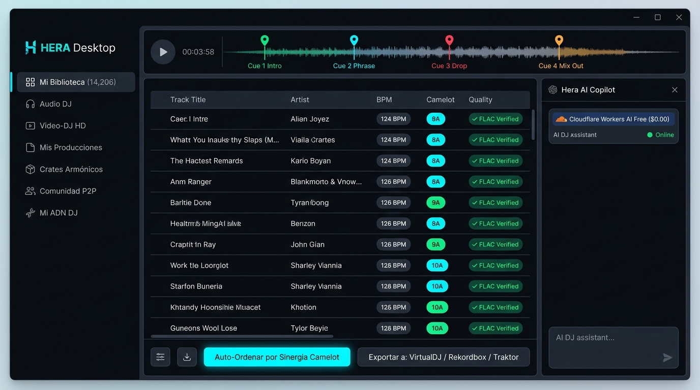
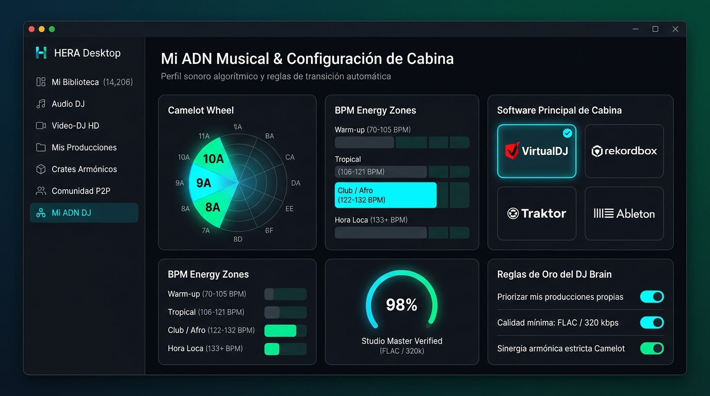
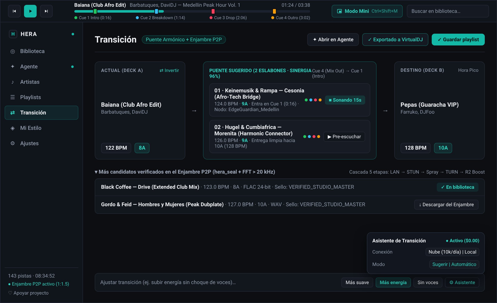

# HERA & HERA-CLOUD — Estrategia de Producto, Casos de Uso Reales y Alineación de Negocio

**Fecha:** 2026-11-08  
**Estado:** En Brainstorming / Planeación Activa  
**Filosofía Central:** *"Hera es un agente que le quita trabajo pesado al DJ en su propia laptop, y conecta una comunidad global de DJs que comparte música."*

---

## 1. Estrella Polar (Verdades Descubiertas en la Sesión)

1. **La Laptop del DJ es el Centro del Universo (`Local-First Real`):**
   - El DJ **no quiere sus canciones encerradas en Cloudflare R2**.
   - El DJ necesita los archivos `.flac` / `.mp3` / `.mp4` **descargados físicamente en una carpeta de su propia laptop** (donde corre VirtualDJ, Rekordbox, Traktor o Serato) o listos para pasar a su pendrive USB.
2. **Por qué un DJ usa (o pagaría por) Hera:**
   - Nadie paga por "otro Dropbox/R2". El valor real es **quitarle al DJ las 4–6 horas de carpintería musical** antes de un toque:
     - Auditar y organizar un repertorio caótico existente (ej. `14,200+` tracks de Audio, Video-DJ y Producciones Propias).
     - Buscar y descargar a su disco duro lo que le falta sin comerse falsos FLACs (auditoría espectral FFT).
     - Etiquetar BPM, llave Camelot, LUFS y estampar los **4 Hot Cues estructurales**.
     - Armar las carpetas de sets (`sets/` y `exports/`) listas para abrir en su software de DJ.
3. **El Rol Real de la Comunidad P2P y de `hera-cloud`:**
   - **Comunidad P2P:** Mientras el DJ usa Hera en su laptop para organizar y armar sus sets, su biblioteca curada comparte música automáticamente con otros DJs del mundo (`slskd` + nodos P2P).
   - **`hera-cloud` (Re-enfocado):** No es un disco duro masivo para encerrar música en la nube, sino el **Cerebro e Índice Global de la Comunidad** (directorio de quién tiene qué master verificado, qué Hot Cues tiene cada canción, buscador de puentes armónicos y proveedor del Agente IA para el DJ que no tiene Antigravity ni API Keys propias).

---

## 2. Casos de Uso Validados (Ordenados por Valor Real)

### Caso de Uso #1: Organización e Inteligencia de Repertorio Local (Probado en Vivo)
- **Dolor:** El DJ tiene miles de canciones, videos HD y producciones propias desordenadas en su disco duro, con duplicados, nombres sucios y archivos sin BPM/Camelot.
- **Solución en Hera (`src/hera/domain/repertoire_intelligence.py`):**
  - Escanea las carpetas locales del DJ, clasifica en Audio DJ, Video-DJ y Producciones Propias.
  - Agrupa por zonas de energía reales (`70-105`, `106-121`, `122-132`, `133+` BPM), detecta años inactivos y sospechosos de bajo bitrate.
  - Sincroniza `hera.db` *in-place* (`sync_local_library_to_db`) para que el agente conozca cada canción que el DJ tiene en su máquina.

### Caso de Uso #2: Del Brief al Set Físico en la Laptop (con Filtro Anti-Basura)
- **Dolor:** Armar un set nuevo de 60–90 minutos buscando canción por canción, verificando calidad real y ordenando transiciones armónicas.
- **Solución en Hera:**
  - Revisa primero `hera.db` local para no descargar duplicados (`[SKIP - YA EXISTE]`).
  - Descarga lo faltante desde la red P2P a `quarantine/`, valida espectro real con FFT (`hera-rs/src/forensics.rs` / `librosa`), etiqueta con `mutagen` y promueve a `library/`.
  - Secuencia el crate con el motor de sinergia de 4 capas (Camelot + curva BPM + transientes + estilo).

### Caso de Uso #3: Integración Nativa con el Software donde Toca el DJ (VirtualDJ, Rekordbox, Traktor, Ableton)
- **Dolor:** Cada DJ trabaja en un ecosistema distinto en su laptop:
  - **VirtualDJ (Caso principal validado):** Necesita leer carpetas físicas, playlists `.m3u8` o archivos `.vdjfolder` / `<Poi>` con los 4 Hot Cues.
  - **Rekordbox (Pioneer CDJs):** Necesita `rekordbox.xml` con `<TEMPO>` y `<POSITION_MARK>` (ya implementado en `src/hera/domain/export.py`).
  - **Traktor Pro:** Necesita `collection.nml` con `<CUE_V2>` para los 4 Hot Cues.
  - **Ableton Live:** Necesita `[BPM]_[Camelot]_[Artist] - [Title].ext` con hardlinks `os.link` (ya implementado en `src/hera/domain/export.py`).

### Caso de Uso #4: Accesibilidad Radical para Cualquier DJ del Mundo (`$0.00 USD`, Sin Tarjeta de Crédito en Dólares y Sin Ser Programador)
- **Dolor Real (Contexto Venezuela / LATAM y DJs no técnicos):**
  - La mayoría de los DJs no tienen tarjeta de crédito internacional en dólares para pagar suscripciones de OpenAI/Claude, ni usan editores de código como Antigravity/Cursor, ni tienen una PC gamer de `32 GB RAM` para correr modelos pesados locales (y además mientras tocan en vivo no pueden saturar la CPU/RAM de la laptop con un modelo pesado porque el audio de VirtualDJ/Rekordbox haría *dropouts*).
- **Solución en 3 Pilares Claros y Honestos (Cero Heurísticas Tramposas):**
  1. **Pilar 1 — Sin Internet / Modo Determinista: Botones y Formularios Visuales en el Front (`hera ui`):**
     - **Principio de Ingeniería:** Nada de "heurísticas tramposas de chat" simulando ser IA cuando estás offline. Si el DJ no tiene internet (o está en pleno club tocando), necesita **botones, selectores y controles deterministas** en la interfaz gráfica (`src/hera/ui/app.py`):
       - **Botón [🔍 Auditar y Sincronizar Repertorio]:** Escanea carpetas locales y actualiza `hera.db` con 1 clic.
       - **Panel [🎛️ Armar Set / Crate Armónico]:** Selectores visuales de Género, Rango BPM (ej. `122–126`), Llave Camelot inicial (`8A`), Duración (`60 min`), check de *Incluir mis producciones* y formato de exportación (**VirtualDJ / Rekordbox / Traktor / Ableton**).
       - **Buscador Directo P2P [📥 Buscar y Descargar]:** Caja de búsqueda con tabla de candidatos, score de calidad y botón de descarga directa a `quarantine/` ➔ `library/`.
  2. **Pilar 2 — Por Defecto con Internet: Capa Gratuita Exprimida al Máximo con la Suite Cloudflare AI (`hera-cloud` Default):**
     - **¿Cuánto nos da Cloudflare AI gratis antes de que empiece a doler? (`https://developers.cloudflare.com/ai/`):**
       - **Workers AI (`10,000 Neurons/día` Gratis, se reinicia cada 24h a las 00:00 UTC):**
         - Si usamos un modelo gigante (`llama-3.3-70b`), consume `26,668 neurons / 1M input` y `204,805 neurons / 1M output` (~150 mensajes/día gratis).
         - **El Truco Maestro (Enrutamiento por Modelo Ligero):** Usando **`@cf/meta/llama-3.1-8b-instruct-fp8-fast`** o **`@cf/meta/llama-3.2-3b-instruct`**, solo consume **`~4,119 neurons / 1M input`** y **`~30,475 neurons / 1M output`**. Un turno de un DJ en Hera (~500 tokens de entrada + 150 de salida) gasta apenas **~6.6 Neurons**, lo que nos da **~1,500 mensajes de DJ por día 100% GRATIS (`$0.00`)** por cada nodo Cloudflare Worker.
         - Y si algún día se pasa del límite gratuito en el plan de `$5/mes`, cada `1,000 Neurons` extra cuesta apenas **`$0.011 USD` (1 centavo de dólar por ~150 mensajes)**.
       - **Cloudflare AI Gateway (`100% Gratis`):**
         - **Caché Global (`cf-aig-cache-status: HIT`):** Si dos DJs hacen preguntas similares de armonía o recomendaciones, responde desde el caché de Cloudflare gastando **`0 Neurons` (`$0.00`)** y con `90%` menos latencia.
         - **Rate Limiting por DJ (`Sliding Window`):** Limita p. ej. a `30 mensajes/hora` por usuario gratuito para que un solo usuario o bot nunca agote las `10,000 Neurons/día` de la comunidad.
         - **Fallback Automático Sin Código:** Si las `10,000 Neurons` del día se llenan, AI Gateway hace *fallback* automático a un modelo `:free` de **OpenRouter** o **Google Gemini Free Tier** sin que el DJ note ningún corte.
       - **Cloudflare Vectorize (`Gratis hasta 5M dimensiones almacenadas y 30M consultadas/mes`):**
         - Permite buscar canciones por descripción semántica natural (*"canciones con vocales femeninas hipnóticas para cerrar a las 4 AM"*) cruzado con `D1` y `SimHash POPCNT` a costo `$0.00`.
  3. **Pilar 3 — Panel de Configuración de IA Intuitivo y Bonito en el Front (Como el 99% de las Apps Modernas):**
     - En el frontend (`hera ui`), ofrecer un panel visual limpio y amigable donde el usuario que quiera personalizar su motor de IA pueda elegir con 1 clic:
       - 🌐 **Hera Cloud Free (Cloudflare Workers AI)** — *Activado por defecto (`$0.00`, cero configuración).*
       - 🔑 **OpenRouter / Gemini / Groq / OpenAI / Anthropic** — *Campo visual limpio para pegar tu API Key y elegir modelo de una lista desplegable (incluyendo modelos `:free` de OpenRouter).*
       - 💻 **Motor Local (Ollama / LM Studio)** — *Opcional para quienes tengan una laptop potente y quieran correr modelos locales.*

### Caso de Uso #6: Onboarding Inteligente del DJ y Auto-Cálculo de "ADN y Estilo del DJ" (`DJ Style Profiler`)
- **La Idea:** Cuando un DJ entra a Hera por primera vez, el sistema no debe empezar en blanco ni hacerle llenar un formulario aburrido de 50 campos: debe hacerle un **Onboarding Guiado + Análisis Automático de su Estilo Musical** y recordarlo para siempre en su `DJ Brain` (local en `hera.db` y sincronizado en `hera-cloud` D1).
- **Cómo Funciona en 2 Pasos (Humano + Agente Analista):**
  1. **Paso 1 — Auto-Extracción del ADN del DJ desde sus Carpetas Locales (`Zero-Typing Style Discovery`):**
     - El DJ solo selecciona su carpeta de música en la laptop (o le da al botón **[Analizar Mi Estilo]**).
     - Aprovechando y expandiendo `artist_dna_profile` en `src/hera/domain/repertoire_intelligence.py` + `style_embeddings.py` / `structure.rs`, el agente analiza las canciones que el DJ ya tiene en su disco y deduce automáticamente:
       - **Zonas de BPM Favoritas** (ej. *Warm-up Urbano 70-105 BPM*, *Club/Afro/Tech House 122-128 BPM*, *Hora Loca 133+ BPM*).
       - **Firma Armónica Dominante** (sus 5 llaves Camelot más usadas, ej. `8A`, `9A`, `10A`, `5A`).
       - **Subgéneros y Textura Acústica** (percusivo, vocal, melódico, video-DJ HD, producciones propias).
       - **Artistas Ancla / Referentes** (los top 15 artistas que más repite en su colección).
  2. **Paso 2 — Entrevista Rápida de Onboarding (3–4 Preguntas Clave en UI / Chat):**
     - Hera le presenta al DJ su "Radiografía Musical" recién calculada (*"¡Hola! Analicé tus carpetas: veo que dominas el rango 122-128 BPM en tonos menores 8A/9A y tienes videos HD..."*) y le confirma 4 cosas clave para cerrar su perfil:
       1. **Nombre Artístico (`dj_handle`) y País/Ciudad.**
       2. **Software Principal de Cabina:** `VirtualDJ` / `Rekordbox` / `Traktor` / `Serato` / `Ableton Live` (para saber en qué formato exportarle siempre por defecto).
       3. **Estilo de Mezcla y Transición Preferido:** *Mezclas largas y progresivas (32-64 compases)* vs. *Cortes rápidos / Open-Format / Hora Loca* vs. *Video-DJ*.
       4. **Reglas de Oro Personales ("Nunca / Siempre"):** ej. *"Siempre incluir al menos 1 producción mía en cada set"*, *"Nunca poner canciones de menos de 320 kbps"*, *"Evitar tales artistas/géneros"*.
  3. **Paso 3 — Memoria Continua (`Todo queda en el Brain`):**
     - Todo se guarda en `dj_preferences` + `dj_brain_profile` en `hera.db` local y se respalda en Cloudflare D1 (`hera-cloud`).
     - Además, en cada conversación futura, si el DJ corrige algo (*"no me pongas reggaetón viejo en los sets de club"* o *"cámbiame el cue de salida a 16 compases"*), el agente actualiza automáticamente su `DJ Brain` sin que el DJ tenga que volver a explicarlo jamás.

---

## 3. Ideas Capturadas para el Plan de Implementación (`docs/superpowers/plans/2026-11-08-dj-laptop-first-product-plan.md`)

1. **Paneles y Botones Deterministas en el Front (`src/hera/ui/app.py`) para Uso Offline/Directo:**
   - Reemplazar los botones que hoy solo inyectan texto al chat por controles visuales deterministas (Auditoría de Repertorio, Constructor Visual de Crates con selectores de BPM/Camelot/Duración/Exportación, y Buscador P2P directo) que funcionen al 100% sin internet y sin LLM.
2. **Capa Gratuita por Defecto con Cloudflare Workers AI (`hera-cloud` + `src/hera/agent/backends.py`):**
   - Exponer un endpoint compatible con OpenAI/Tools en `hera-cloud` respaldado por la suite **Cloudflare Workers AI (`env.AI`) + AI Gateway**, y configurarlo como el backend `cloudflare_free` por defecto en Hera para que cualquier DJ de Venezuela o el mundo abra la app y el agente ya funcione gratis.
3. **Configurador Visual de Motores LLM en el Frontend (`OpenRouter`, `Gemini`, `Ollama`, etc.):**
   - Diseñar en `src/hera/ui/app.py` una tarjeta de configuración intuitiva y bonita donde el DJ pueda cambiar entre el modo gratuito por defecto (Cloudflare AI), pegar una clave de **OpenRouter** (con filtro de modelos gratuitos y pagos), **Gemini**, o conectar **Ollama / LM Studio** local si su máquina lo permite, guardando la preferencia en `config/hera.toml`.
4. **Exportador Nativo VirtualDJ y Traktor (`src/hera/domain/export.py`):**
   - Añadir exportación de VirtualDJ (`.vdjfolder` + inyección opcional de `<Poi>` de los 4 Hot Cues acústicos) y Traktor (`traktor.nml` con `<CUE_V2>`), uniéndose a Rekordbox XML, M3U8 y Ableton Live.

---

## 4. Definición Oficial del Stack (Frontend + Backend Local + Backend Cloud) y Rediseño UI (`Layout martpie/museeks` + `Svelte 5`)

Con el cambio de paradigma (**"Hera es el Asistente, Organizador de Repertorio y Conector P2P que prepara tus sets para tu software real de DJ"**), reemplazamos el viejo reproductor Dual-Deck de Streamlit por una arquitectura nativa ultraligera inspirada en el layout de **[`martpie/museeks`](https://github.com/martpie/museeks)** pero potenciada con **Svelte 5 (sin Virtual DOM)**:

### A. Stack de Frontend (`HERA Desktop`)
- **Desktop Shell:** **Tauri v2 (`src-tauri` en Rust)** — instalador nativo diminuto (`~5–8 MB`), WebView nativo del SO + icono en bandeja (`System Tray`), consumo mínimo de RAM/CPU para nunca interferir con `VirtualDJ`, `Rekordbox` o `Traktor` en vivo.
- **UI Framework:** **Svelte 5 (`Runes`, Zero Virtual DOM) + TypeScript + Vite**
  - **¿Por qué Svelte 5 en lugar de React?** Mientras `martpie/museeks` nos sirve de molde visual y de arquitectura Tauri+Rust+SQLite, **descartamos React** porque su Virtual DOM consume más memoria y ciclos de CPU en tablas masivas. **Svelte 5** compila directo a operaciones nativas del DOM con reactividad granular (*Runes*), permitiendo hacer scroll por `+14,200` canciones a `60 FPS` y mover el cursor del waveform de 1 pista con los **4 pines de Hot Cues clicables** (`🟢 Cue 1 Intro`, `🔵 Cue 2 Phrase`, `🔴 Cue 3 Drop`, `🟡 Cue 4 Mix Out`) con huella casi cero de RAM.

### B. Stack de Backend Local (En la Laptop del DJ — `davidcastilloc/hera`)
- **Motor Nativo Rust (`hera-rs/` — `hera-node-rs`):**
  - `Symphonia` + `rustfft` (auditoría espectral Zero-Trust, detección de falsos FLACs, correlación de fase `<120 Hz` y detección acústica de los 4 Hot Cues).
  - Motor de sinergia de 4 capas + optimizador **`2-Opt TSP`** + búsqueda **`u64 SimHash POPCNT`**.
  - Servidor local/IPC (`axum` + comandos Tauri) + protocolo **`MCP` (`stdio` + HTTP + `Code Mode`)** + nodo del Enjambre Post-P2P de 5 capas (`Merkle Proofs`, `endpoint_pubkey_id`, `Latency-Aware P2C Striping`, `Delta-CRDT`, `MoQ Pub/Sub`).
- **Orquestador de Dominio, `DJ Brain` y Exportadores en Python (`src/hera/`, Python `>=3.11` + `uv`):**
  - **Base de Datos Local:** **SQLite (`hera.db` vía `aiosqlite`)** con el catálogo físico (`tracks`, `crates`), ADN y preferencias (`dj_preferences`) e historial de sesiones (`conversation_sessions`, `conversation_messages`).
  - **Inteligencia de Repertorio (`repertoire_intelligence.py`):** Clasifica Audio DJ, Video-DJ HD y Producciones Propias, zonas BPM y llaves Camelot dominantes.
  - **Exportadores Nativos (`export.py`):** `VirtualDJ` (`.vdjfolder` + `<Poi>`), `Rekordbox` (`rekordbox.xml`), `Traktor Pro` (`collection.nml` `<CUE_V2>`), `M3U8` y `Ableton Live`.
  - **Descarga Física a Disco (`slskd` + `rclone`):** Flujo estricto `quarantine/` ➔ auditoría FFT ➔ `mutagen` ➔ `library/` ➔ `sets/`.

### C. Stack de Backend Cloud (`davidcastilloc/hera-cloud` — `$0.00` Base)
- **Runtime Edge:** **Cloudflare Workers (`Rust` -> `wasm32-unknown-unknown`, `worker 0.4` + `axum`)**.
- **IA Gratuita por Defecto:** **Cloudflare Workers AI (`10,000 Neurons/día` gratis con `@cf/meta/llama-3.1-8b-instruct-fp8-fast` / `llama-3.2-3b-instruct` ≈ 1,500 turnos/día a `$0.00`)** + **Cloudflare AI Gateway** (caché global `0 Neurons`, rate-limiting y fallback dinámico a modelos `:free` de OpenRouter/Gemini).
- **Super DB & Memoria Sincronizada:** **Cloudflare D1 (`5 GB` SQLite gratis ≈ 14M mensajes de `DJ Brain` + índice global de `hera_seal` y 4 Hot Cues)** + **Cloudflare Vectorize** (`5M` dimensiones gratis) + **Cloudflare R2 (`Zero-Egress`)**.

### D. Los 5 Módulos Reales de `HERA Desktop` (`Svelte 5 + Tauri v2`):
1. **Módulo 1 — 🧬 Onboarding & Mi ADN de DJ (`DJ Brain & Style Profile`):**
   - Radiografía visual automática de su estilo (zonas BPM, rueda Camelot dominante, artistas ancla, % Audio vs. Video-DJ vs. Producciones Propias) + configuración de su software principal (`VirtualDJ`, `Rekordbox`, `Traktor`, `Ableton`) y reglas de oro.
2. **Módulo 2 — 🗂️ Biblioteca & Auditor de Repertorio (`TrackList Virtualizada en Svelte 5 + 1-Click Doctor`):**
   - Tabla ultrarrápida conectada a `hera.db` con buscador instantáneo, filtro por BPM/Camelot, detector de duplicados/falsos FLAC (FFT) y reproductor superior simple con salto a los 4 Hot Cues.
3. **Módulo 3 — 🎛️ Creador de Crates y Sets Armónicos (`Deterministic + AI Crate Builder`):**
   - Funciona tanto con **controles visuales directos (offline)** como con el **Chat del Agente (online)** y botón **[Exportar directo a mi VirtualDJ / Rekordbox / Traktor / Carpeta USB]**.
4. **Módulo 4 — 🌍 Comunidad Global P2P & Puentes Armónicos (`Discovery & Download to Disk`):**
   - Buscador directo de tracks y "Puentes Armónicos de Emergencia" (`resolve-bridge` / `similar`) en la red de DJs, descargando el archivo físico verificado directo a la carpeta local del DJ.
5. **Módulo 5 — ⚙️ Configuración Limpia de IA & Red (`Zero-Friction Settings`):**
   - Selector visual entre **Cloudflare Workers AI Free (Activo por defecto)**, **OpenRouter / Gemini / OpenAI (BYOK)** y **Modelos Locales (Ollama/LM Studio)**.

### 3. Mockups Visuales de Referencia (`docs/superpowers/assets/`)

1. **Vista 1 — Biblioteca, Reproductor Simple de 4 Hot Cues y Copiloto IA:**
   
2. **Vista 2 — Mi ADN Musical, Onboarding y Configuración de Cabina:**
   
3. **Vista 3 — Puente Armónico Inteligente y Comunidad P2P:**
   
