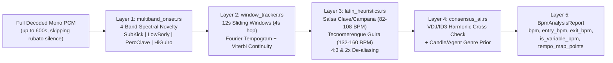

# HERA v0.7.0 — Real-World PC QA Architecture: 5-Layer BPM Engine (Salsa, Variable BPM & Tecnomerengue), Anti-Empty-Zone 8-Cue Merger (`>= 50%`), CD-Skip Forensics, Mixed Audio+Video Crates (`< 10m` Mixes), Shazam DNA & Cancellable Scanner

**Date:** 2026-11-11  
**Repository:** `davidcastilloc/hera` (`hera-rs`, `hera-ipc`, `hera-desktop`)  
**Companion Private Repo:** `davidcastilloc/hera-cloud`  
**Status:** Approved Design Specification (`superpowers-odd` Multi-Instance Handoff)

---

## 1. Context & Empirical QA Findings on DJ PC

During live QA on the DJ's primary PC against a real Latin + Open-Format library (Salsa, Merengue, Tecnomerengue, Urbano, Club, Audio + Video files, and VirtualDJ history), 10 concrete product & DSP gaps surfaced:

1. **Hot Cues Landing in Empty Zones & Second-Half Structural Cues (*"Tú me vas a llorar"*):**
   - **Root Cause:** `hera-desktop/src-tauri/src/libs/track.rs` invokes `decode_audio_file_partial(path, 45.0)`, decoding only the first `45s`. For the remaining `80%+` of the track, `hera-rs/src/structure.rs` (`mix_out_bar` fallback around line 306) projects Cue 4 mathematically (`n_bars_total - 8`) on un-decoded audio without checking whether that bar is a beatless vocal breakdown, reverb tail, or silence.
   - **DJ Calibration:** Keep 1 real entry cue (`Cue 1` at `1.1.1` downbeat), enforce a strict **Anti-Empty-Zone Gate**, never overwrite manual VirtualDJ/Rekordbox cues (`1..8`), and place HERA's proposed structural cues **from the midpoint (`>= 50%`) of the song onward (`Pads 5..8`)**, mirroring the DJ's manual `Cue 5` and `Cue 8` in *"Tú me vas a llorar"*.
2. **BPM Calculation Failures (General Audit, `Salsa`, `Variable BPM` where VirtualDJ also fails, and missing `Tecnomerengue`):**
   - **Root Cause Audit of `hera-rs/src/structure.rs` (`estimate_bpm_from_flux` & `normalize_dj_bpm`):**
     1. *45s Truncation Blindness:* Long *rubato* / orchestral / piano / bolero intros (`30–60s`) dominate the `45s` window before the percussion groove enters.
     2. *Sub-Bass Bias vs. Salsa's Syncopated Tumbao:* Weighting `sub_flux` (`20–135 Hz`) at `1.45x` fails on Salsa (`82–108 BPM`), where there is **no kick drum on beat 1** and the baby-bass plays the anticipated *tumbao* on beats `2.5` and `4` (`1.5` + `2.5` beat intervals), generating false `4/3x` (`~124–138 BPM`) or `2/3x` autocorrelation peaks.
     3. *Single Global ACF Smears Variable BPM:* Live drummers and classic Salsa/Merengue orchestras drift `+3%..+9%` from intro to *montuno*. A single global lag correlation de-phases over 4 minutes — the same reason VirtualDJ's rigid linear beatgrid fails on variable-BPM songs.
     4. *Narrow Sweep Ceiling `[75.0 .. 148.0]` & `> 155 BPM` Folding:* Caps `Tecnomerengue` (`132–160 BPM`) and fast Merengue at `148 BPM` or folds `156 BPM` in half to `78 BPM`, while unconditional `0.75x` dembow de-aliasing can corrupt `120 BPM` tropical/club tracks into `90 BPM`.
     5. *Over-Aggressive Integer Snapping (`±0.40 BPM`):* Forces live/vinyl fractional tempos (`92.35 BPM` -> `92.0 BPM`), accumulating `> 1.5` beats of phase error by the outro.
     6. *Blind Trust in `bpm_hint`:* Accepts external tag/VDJ BPM verbatim without verifying octave (`0.5x`/`2x`), polyrhythmic (`0.75x`/`1.333x`), or variable-tempo drift errors.
3. **Mixed Audio + Video Crates & `< 10 Minutes` Mixes Rule:**
   - DJ crates are not audio-only; they mix **Audio + Video** (`.mp4`, `.mov`, `.mkv`, `.webm`, `.m4v`).
   - Any file `> 10 minutes` (`> 600s`) is a recorded **Mix / Session**, never an individual crate track. It must be excluded from normal crates and routed logically to HERA's **Mixes Area (`> 10m`)** **without moving or touching the file on disk**.
4. **Scratched-CD / Audio Skip Detection (*"21. Eres tú"*):**
   - **Root Cause:** `hera-rs/src/forensics.rs` breaks out of packet loops on `decoder.decode(&packet)` errors instead of counting corrupted frames, and `audit_pcm_channels` only measures spectral bandwidth/clipping rather than abrupt micro-dropouts or repeated-buffer stutters.
5. **Conversational Curatorial Memory in `/agent`:**
   - **Golden Pairs:** *"17. Perdóname mi vida + 20. Conquístame juntas suenan excelente"* -> persist high-affinity pair (`GoldenTransitionPair`) so 2-Opt TSP chains them together.
   - **Track Retirement:** *"Clavelito ya no"* -> persist `ExcludedTrackRule` so automatic crates skip it without deleting the user's file.
   - **Cue Coaching:** *"En la canción de 'Tú me vas a llorar' el cue 5 y el cue 8 que puse yo fue mejor"* -> inspect the DJ's real Cues `5` and `8`, update the active playlist, and train the genre template (`GenreCueTemplate`), asking 1-click confirmation before applying library-wide.
6. **Learning Everything Possible from VirtualDJ / Rekordbox History:**
   - Parse `VirtualDJ/database.xml`, `VirtualDJ/History/*.m3u`, and `rekordbox.xml` (`<Poi>`, `<POSITION_MARK>`, `PlayCount`, `<Scan Bpm=...>`, historical transition pairs).
7. **Shazam-Like Acoustic Identification + Full Track DNA:**
   - Spectral constellation peak fingerprinting `(f1, f2, dt)` + hybrid lookup (Local DB + HERA P2P Swarm + AcoustID/MusicBrainz open catalog) + full HERA acoustic DNA without renaming disk files.
8. **Workable Material Discovery Agent + Efficient Cancellable Scanner:**
   - Pre-evaluate folders to separate workable tracks (`30s..600s` audio/video), long mixes (`> 600s`), damaged/skipped tracks, and non-DJ clutter (`< 25s` SFX, voice notes, system folders).
   - Two-phase scan (instant metadata/XML pass + background DSP pass) with `< 100ms` cancellation (`AtomicBool` + `cancel_library_scan`).
9. **Missing System Tray Tooltip:**
   - **Root Cause:** `hera-desktop/src-tauri/src/main.rs` never initializes `TrayIconBuilder`.
10. **Initial Onboarding Wizard + Explicit `BETA` Project Badge:**
    - First-run `OnboardingWizardModal.tsx` configuring DJ handle, DJ software, workable folders, and initial style rules, paired with a permanent **`BETA`** badge in the studio chrome.

---

## 2. Core Invariants & Non-Negotiable Guardrails

1. **`Don't break the user space` (Sacred Disk Invariant):**
   - HERA NEVER moves, renames, alters, or deletes the DJ's audio/video files or folders on disk when classifying `> 10m` Mixes, retiring tracks (*"Clavelito ya no"*), flagging scratched tracks (*"21. Eres tú"*), or identifying tracks via Shazam DNA.
   - Before writing cue/metadata updates back to `VirtualDJ/database.xml`, HERA always writes a timestamped `.bak` backup and preserves every manual DJ `<Poi>` (`CueOrigin::DjManual`).
2. **Immutable Golden Masters (`ADR-028`):**
   - All 4 characterization snapshots in `hera-rs/tests/snapshots/` (`mcp_21_tools_catalog`, `forensics_and_4_hot_cues`, `dj_style_dna_signature`, `curator_2opt_tsp_and_spine_routes`) MUST remain `100%` bit-identical (`cargo test -p hera-node-rs --test golden_masters` passes with `0` snapshot diffs).
   - **Strategy:** Keep existing public entrypoints (`audit_pcm_channels`, `analyze_structure_and_style`, `optimize_crate_2opt`, `optimize_crate_with_spine`, `list_mcp_tools`) preserving their exact 4-cue / 6-track outputs, or guard optional extension fields with `#[serde(default, skip_serializing_if = "...")]`, while exposing explicit V2 domain entrypoints (`analyze_bpm_consensus`, `analyze_structure_8cues`, `audit_pcm_with_glitch_scan`, `optimize_crate_with_dj_rules`) for Desktop, CLI, and Loopback Agent consumers.
3. **Architectural Ratchets (`ADR-028` / `ADR-030`):**
   - Every `.rs` file in Leaf-First sliced directories (`hera-rs/src/bpm_engine/`, `hera-rs/src/dj_learning/`, `hera-rs/src/shazam_id/`, `hera-desktop/src-ipc/src/`, `hera-desktop/src-tauri/src/plugins/{hera_dj,hera_agent}/`) MUST stay `<= 349` lines (`content.lines().count()`).
   - Update `EXPECTED_TAURI_COMMANDS_COUNT` in `hera-rs/tests/architectural_ratchets.rs` in exact lockstep with `src-tauri/build.rs`, `capabilities/main.json`, `src-tauri/src/main.rs`, and `.sqlx/` (`cargo sqlx prepare`).
   - Zero manual duplicate IPC interfaces in `bridge-hera.ts` (`<= 3` local union aliases; generate all new DTOs from `hera-desktop/src-ipc/` via `ts-rs` into `hera-typings.ts`).
   - Zero OS-specific user paths in tracked docs/tests (`ratchet_zero_os_absolute_paths_in_docs_and_plans`).
4. **Scope Boundary:**
   - Keep external experimental LLM proxy/router experiments completely out of `hera` and `hera-cloud`.

---

## 3. Deep Technical Design

### 3.1 Five-Layer Multi-Strategy BPM Engine (`hera-rs/src/bpm_engine/`)

1. **Layer 1 — 4-Band Percussive Onset Decomposition (`hera-rs/src/bpm_engine/multiband_onset.rs`, `<= 349` LOC):**
   - Extracts half-wave rectified, local-mean-whitened spectral flux across 4 rhythmic bands:
     - `BandSubKick` (`25–130 Hz`): electronic kick, 808, tambora low hit.
     - `BandLowBody` (`130–450 Hz`): Salsa baby-bass *tumbao*, snare body, conga open tone.
     - `BandPercClave` (`650–3800 Hz`): **Salsa campana (cowbell), bongo *martillo*, conga slap (*quemao* on beats 2 & 4), clave (`2-3` / `3-2`)**.
     - `BandHiGuiro` (`4200–11000 Hz`): **Merengue / Tecnomerengue *güira* steady 16th-note grid**, maracas, club hi-hats.
2. **Layer 2 — Full-Track Sliding-Window Tempo Curve & Variable BPM Detector (`hera-rs/src/bpm_engine/window_tracker.rs`, `<= 349` LOC):**
   - Evaluates overlapping `12.0s` windows (`4.0s` hop) across the entire track (`<= 600s`), discarding beatless/rubato windows whose rhythmic crest/energy falls below `20%` of the track's body median (preventing bolero/orchestral intros from poisoning the BPM).
   - Computes sub-frame parabolic-interpolated comb autocorrelation over `[68.0 .. 220.0] BPM` per window, then runs **Viterbi Dynamic-Programming Continuity Tracking** across windows:
     - Penalizes abrupt octave/harmonic flips (`2x`, `0.5x`, `1.333x`, `0.75x`) between adjacent windows while permitting continuous live-band drift (`±0.6 BPM` per `4s` step).
   - Emits exact DJ transition & beatgrid fields:
     - `bpm`: robust confidence-weighted median across active rhythmic body/montuno windows.
     - `entry_bpm`: median BPM of the first 16 rhythmic bars (used by `synergy.rs` when mixing *into* the track).
     - `exit_bpm`: median BPM of the final mixable section (`70%..92%`, used by `synergy.rs` when mixing *out of* the track).
     - `bpm_min_detected`, `bpm_max_detected`, `tempo_drift_bpm`, `tempo_drift_pct`, `window_iqr_bpm`.
     - `is_variable_bpm`: `true` when `tempo_drift_bpm >= 1.8` or `tempo_drift_pct >= 1.8%` across high-confidence windows.
     - `tempo_map_points: Vec<TempoAnchorPoint>`: piecewise dynamic beatgrid anchors (`seconds`, `local_bpm`, `confidence`) for variable-tempo songs where VirtualDJ's single linear grid fails.
3. **Layer 3 — Salsa, Tecnomerengue & Polyrhythmic De-Aliasing (`hera-rs/src/bpm_engine/latin_heuristics.rs`, `<= 349` LOC):**
   - **Salsa Tumbao & Clave Solver (`82–108 BPM` Canonical DJ Scale):**
     - Detects the *Syncopated Tumbao Signature*: `BandPercClave` (`650–3800 Hz`) periodicity exceeds `BandSubKick`, while `BandLowBody` (`130–450 Hz`) exhibits a dip at `1.0 * beat_lag` (missing beat 1 bass) alongside strong peaks at `2.0 * beat_lag` (conga slap on `2 & 4`) and `4.0 * beat_lag` (bar cycle).
     - Down-weights `BandSubKick` (`0.25`) and locks onto `BandPercClave` (`1.55`) + `BandHiGuiro` (`0.65`) + `2-beat` / `4-beat` comb harmonics.
     - Resolves `4/3x` (`~124–140 BPM`) and `3/2x` cross-rhythm aliases back to the true quarter-note pulse (`90–105 BPM`) and folds double-time (`164–216 BPM`) by `0.5x` into **`82–108 BPM`** so Salsa bridges seamlessly with Reggaetón/Urbano/Tropical.
   - **`Tecnomerengue` & Fast Merengue Classifier (`132–160 BPM` Canonical Scale):**
     - Detects binary `2/4` tambora/kick (`BandSubKick` + `BandPercClave` synth brass transients, `punch_index >= 0.56`) coupled with continuous `4x` 16th-note `BandHiGuiro` (*güira* energy in `4.2–11 kHz`).
     - Classifies `top_subgenre = "Tecnomerengue"` (`132–160 BPM`) and **disables the legacy `bpm > 155.0 => bpm * 0.5` halving bug** whenever fast binary merengue/güira pulse is present (unfolding half-time `66–80 BPM` detections back to `132–160 BPM`).
   - **Guarded Dembow De-Aliasing & Fractional Precision:**
     - Restricts `0.75x` tresillo de-aliasing strictly to tracks exhibiting genuine `3:3:2` snare-over-kick signature, never altering `120–132 BPM` four-on-the-floor Club or `132–160 BPM` Tecnomerengue.
     - Snaps to integer BPM *only* when `!is_variable_bpm && window_iqr_bpm < 0.15 && (bpm - bpm.round()).abs() <= 0.10`; otherwise preserves `0.01 BPM` precision.
4. **Layer 4 — 4-Pillar Metadata + AI Consensus Arbiter (`hera-rs/src/bpm_engine/consensus_ai.rs`, `<= 349` LOC):**
   - Treats `VirtualDJ <Scan Bpm>`, Rekordbox `AverageBpm`, ID3 `TBPM`, and filename `[95BPM]` tokens as a **weighted harmonic vote** rather than an unconditional override:
     - If `is_variable_bpm == true` and external BPM disagrees or represents a smeared average, HERA keeps the windowed curve (`bpm`, `entry_bpm`, `exit_bpm`) and emits diagnostic `"BPM Variable (inicio -> final)"`.
     - If external BPM stands in an octave/polyrhythmic ratio (`2.0x`, `0.5x`, `1.333x`, `0.75x`) to HERA's DSP candidate, resolves the scale using **Genre/Artist Prior + `CandleLocalDjModel` (`< 1 ms` CPU)** (e.g., Salsa icons/tags -> `82–108 BPM`; Tecnomerengue icons/tags -> `132–160 BPM`; Reggaeton -> `80–102 BPM`; Tech House/Guaracha -> `122–132 BPM`).
     - Flags `bpm_needs_review = true` whenever `bpm_confidence < 0.72`, surfacing a 1-click audit/tap/AI-recheck pill in the UI and `/agent`.

---

### 3.2 Anti-Empty-Zone 8-Cue Engine (`>= 50%` Rule) & Smart VDJ/Rekordbox Merger (`hera-rs/src/cue_engine.rs` & `hera-rs/src/dj_learning/`)

1. **Full-Track Decode (`<= 600s`):**
   - `enrich_track_with_hera_dsp` decodes up to `600.0s` (`10 minutes`, matching the maximum workable track ceiling) so `bar_sub`, `bar_mid`, and `bar_tot` cover `100%` of every workable song.
2. **Anti-Empty-Zone Gate (`snap_bar_to_mixable_attack`):**
   - Any candidate bar `b` with `bar_sub[b] < 0.28 && bar_tot[b] < 0.35` (beatless vocal pad, reverb breakdown, dramatic silence, or fade-out tail) is **strictly rejected** as a cue target and snapped to the nearest phrase-aligned percussive attack (`±4` bars) with real transient onset energy.
3. **Second-Half Structural Layout (`Pads 1, 5, 6, 7, 8`):**
   - `Cue 1`: Real first percussive downbeat (`1.1.1`).
   - `Cues 2..4`: Left free for the DJ's custom early-track markers (or filled from learned `GenreCueTemplate` only if requested).
   - `Cues 5..8` (**strictly `>= 50%` of track duration**, anchored to real non-empty attacks):
     - `Cue 5` (`~50%–56%`): Midpoint chorus / montuno / second-half re-entry anchor.
     - `Cue 6` (`~62%–68%`): Post-bridge rhythmic relaunch.
     - `Cue 7` (`~74%–80%`): Pre-outro transition anchor (16 bars before exit).
     - `Cue 8` (`~84%–90%`): Clean final mix-out downbeat *before* the beatless fade/reverb tail (matching the DJ's manual `Cue 5` & `Cue 8` placement in *"Tú me vas a llorar"*).
4. **Sacred Manual Cues (`CueOrigin::DjManual`):**
   - `merge_8_hot_cues(manual_cues, hera_cues, learned_template)` preserves 100% of manual VirtualDJ/Rekordbox cues (`1..=8`) verbatim and learns normalized relative position distributions (`pos_pct = cue_sec / duration_sec`, local energy contrast, bar distance from end) per subgenre (`GenreCueTemplate`).

---

### 3.3 Forensic Scratched-CD / Skip Detector (`hera-rs/src/forensics_glitch.rs`, `<= 349` LOC)

Detects defective tracks like *"21. Eres tú"* via 3 orthogonal signals during full-track decode:
1. **Container Packet Decode Errors:** Counts `Symphonia` bitstream/CRC/frame decode errors instead of silently terminating the loop.
2. **Abrupt Micro-Dropouts & Phase Cliffs:** Detects `12ms..400ms` digital zero-energy holes (`RMS < 1e-4`) embedded inside sustained loud passages (`surrounding 500ms RMS > 0.10`) bounded by sample-to-sample step discontinuities (`|x[n] - x[n-1]| > 0.55`).
3. **CD-Skip Buffer Stutter / Repeat Loops:** Detects anomalous short-lag exact frame repetitions (`40ms..220ms` adjacent PCM blocks with normalized cross-correlation `> 0.985` and sharp boundary clicks, distinct from musical loops at `>= 1 beat`).
- Populates `has_audio_skips: bool`, `skip_glitch_count: u32`, and `skip_timestamps_seconds: Vec<f32>`, surfacing `⚠️ Saltos / CD rayado` in the library table and prompting confirmation before allowing the track into a live crate.

---

### 3.4 Mixed Audio+Video Crates, `< 10m` Mixes Area & Curatorial Memory (`hera-rs/src/synergy.rs` + `hera-rs/src/dj_learning/`)

1. **Audio + Video Parity:**
   - Adds `.mp4`, `.mov`, `.mkv`, `.webm`, `.m4v` to `SUPPORTED_MEDIA_FORMATS` (`is_video = true`), extracting the audio stream via `symphonia-format-isomp4` / MKV demux for full BPM, Camelot, Glitch, and 8-Cue DSP analysis, and allowing mixed Audio + Video crates in `synergy.rs` and `export.rs` (`.vdjfolder` + `rekordbox.xml`).
2. **Hard `< 10 Minutes` (`<= 600s`) Crate Gate & Logical Mixes Area:**
   - Tracks with `duration_seconds > 600.0` get `is_mix_over_10m = true` in SQLite (`tracks` table).
   - `optimize_crate_with_dj_rules` automatically filters `duration_seconds > 600.0` out of normal DJ crates into `routed_to_mixes_area: Vec<String>`, and the UI exposes a dedicated **`Mixes (> 10m)`** filter/tab — **zero file moves on disk**.
3. **SQLite Curatorial Feedback Rules (`06_create_dj_learning_tables.sql`):**
   - `dj_golden_pairs` (*"17. Perdóname mi vida -> 20. Conquístame"*): injects a `+0.38` lock bonus into the 2-Opt transition matrix (using `exit_bpm` of Track A -> `entry_bpm` of Track B!) so proven pairs stay chained in order.
   - `dj_excluded_tracks` (*"Clavelito ya no"*): excludes retired tracks from automatic crate curation and bridge suggestions without deleting them from disk or library search.
   - `dj_learned_cue_rules` & `dj_feedback_memory`: stores per-genre cue ratios and natural-language coaching turns from `/agent`.

---

### 3.5 Shazam-Like Constellation Identification + Full Track DNA (`hera-rs/src/shazam_id/`)

- **`constellation.rs` (`<= 349` LOC):** Computes peak-picked spectrogram landmarks `(anchor_freq_bin, target_freq_bin, delta_frames)` packed into deterministic 32-bit/64-bit combinatorial hashes (`landmark_hash_u64`, `time_offset_frames`).
- **`matcher.rs` (`<= 349` LOC):** Cascading lookup:
  1. Local SQLite + VirtualDJ `database.xml` landmark index (`< 5 ms`, catches duplicate/untagged copies of songs already in the DJ's collection).
  2. HERA P2P Swarm CAS / Vectorize index (`cas_fingerprint` + `style_simhash_u64`).
  3. Optional Chromaprint/AcoustID + MusicBrainz open metadata resolver when online.
- Returns `TrackDnaIdentificationReport` (Official Artist, Title, Version/Mix, Subgenre, Year + HERA BPM/Variable-BPM curve, Camelot, Glitch status, 64D embedding, and 8 Hot Cues), updating SQLite and `.vdjfolder` while keeping the physical filename untouched unless explicitly requested.

---

### 3.6 Workable Directory Discovery, 2-Phase Cancellable Scanner, System Tray Tooltip & `BETA` Onboarding Wizard (`hera-desktop`)

1. **Workable Material Discovery Agent (`evaluate_music_folder_workability`):**
   - Fast pre-scan (`lofty` headers + file size/extension + folder-name heuristics ignoring `$RECYCLE.BIN`, `System Volume Information`, `WhatsApp Audio`, `Samples`, `SFX`, `node_modules`) classifying files into:
     - `workable_tracks_under_10m` (`30s..=600s` audio/video),
     - `mixes_over_10m` (`> 600s` -> Mixes Area),
     - `short_sfx_or_notes` (`< 30s` -> skipped from DJ crates),
     - `corrupted_or_unreadable`.
2. **2-Phase Cancellable Scanner (`SCAN_CANCEL_FLAG: AtomicBool` + `cancel_library_scan`):**
   - **Phase 1 (`< 2s` for `5,000` files):** Parallel header/tag + `VirtualDJ/database.xml` metadata import so tracks appear immediately in the UI, skipping unchanged `(path, mtime, size)` entries.
   - **Phase 2 (Background Rayon Worker Pool):** Full-track DSP (`BPM Engine` + `8 Cues` + `CD-Skip Detector`) with cooperative `SCAN_CANCEL_FLAG.load(Ordering::Relaxed)` checks before every file and inside the Symphonia packet loop (`< 100ms` stop latency), committing completed batches cleanly to SQLite.
3. **Native System Tray & Live Tooltip (`TrayIconBuilder` in `src-tauri/src/main.rs`):**
   - Registers `TrayIconBuilder::with_id("hera-tray")` with app icon, context menu (`Abrir HERA`, `Modo Mini (Ctrl+Shift+M)`, `Cancelar escaneo`, `Salir`), and `update_tray_tooltip` updating live to `HERA BETA · Sonando: {artist} - {title} [{bpm} BPM · {camelot}]` or `HERA BETA · Escaneando biblioteca ({done}/{total})`.
4. **`OnboardingWizardModal.tsx` + `BETA` Badge:**
   - Visible `BETA` pill in `Navigation.tsx` and window header.
   - 3-step first-run wizard (`persisted in Config: onboarding_completed: bool`): (1) DJ Name + DJ Software auto-discovery (`VirtualDJ/database.xml`, `Rekordbox`) + `BETA` notice, (2) Workable Audio/Video folder discovery preview (showing `< 10m` workable tracks vs `> 10m` Mixes + `"Don't break the user space"` guarantee), (3) Genre priorities (Salsa, Tecnomerengue, Urbano, Club) + cancellable Phase 1/2 scan launch.
