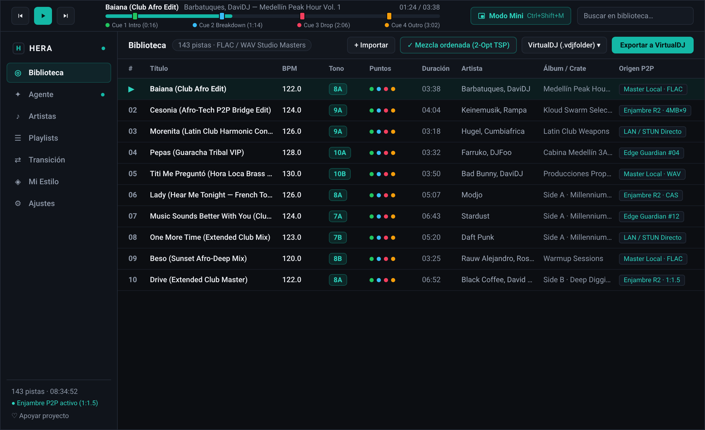
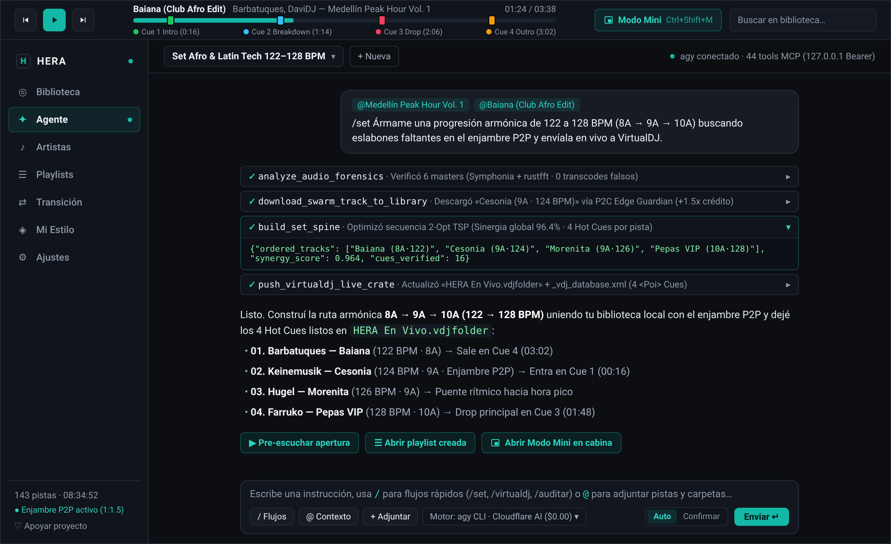
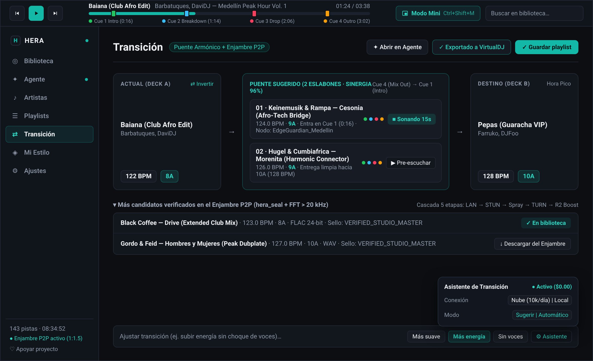
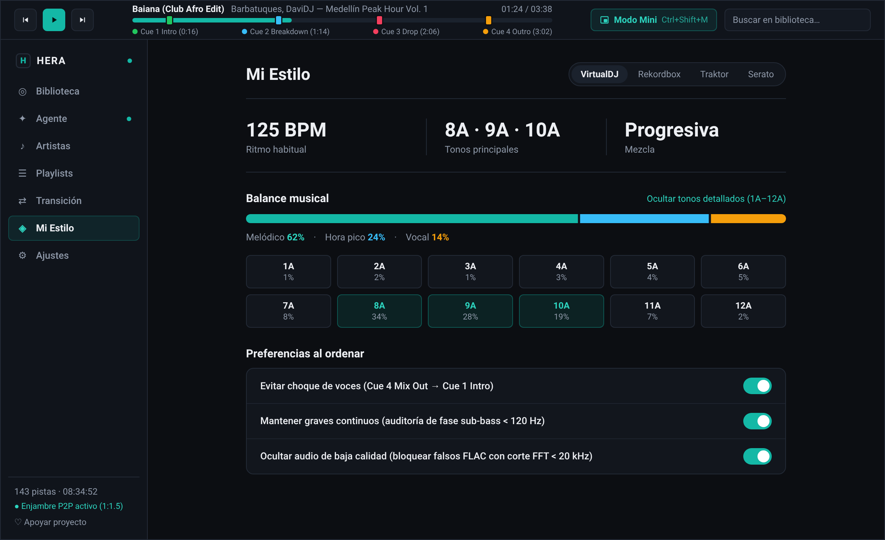
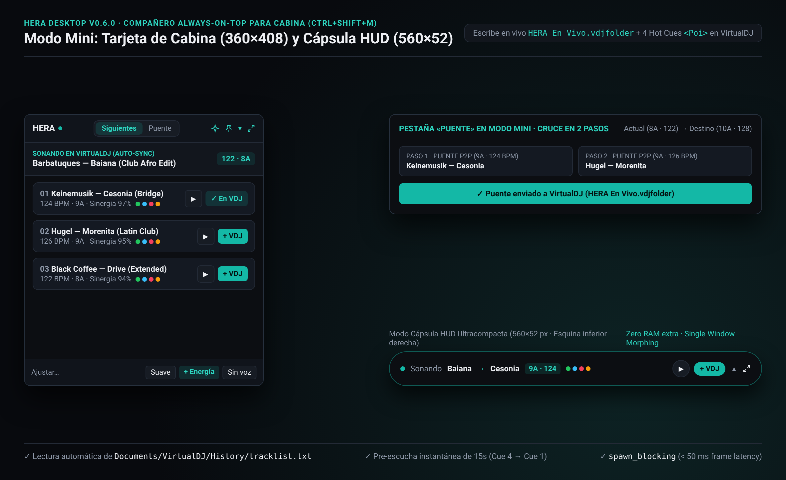

# 🎛️ HERA Desktop (`hera-desktop` `v0.6.0`)

### _El Estudio de Cabina y Agente Autónomo para DJs y Curadores Musicales (`~8 MB` · 100% Rust + Tauri v2 + React 19 + StyleX)_

**HERA Desktop (`v0.6.0`)** es la aplicación nativa de escritorio de HERA construida sobre [`martpie/museeks` (`v0.23.4`, MIT)](https://github.com/martpie/museeks) y extendida con el motor acústico puro en Rust ([`hera-rs`](../hera-rs)) y el guardián hexagonal de contratos ([`hera-ipc`](src-ipc)) para convivir en la misma laptop donde corres **VirtualDJ**, **Rekordbox**, **Traktor** o **Serato** con **0% de consumo parásito de RAM/CPU** y **cero dependencia de Python**.

---

## 📸 Recorrido Visual Completo: Las 5 Pantallas de HERA Desktop (`v0.6.0`)

### 1. Biblioteca DJ + Reproductor con 4 Pines de Hot Cues + Exportador de Cabina (`/library`)



- **Pines Acústicos Interactivos (`TrackProgress.tsx`):** Cada pista analizada con `Symphonia + rustfft` clava automáticamente los 4 momentos estructurales en la barra superior (`🟢 Cue 1 Intro`, `🔵 Cue 2 Breakdown`, `🔴 Cue 3 Drop`, `🟡 Cue 4 Outro`) y los muestra como 4 puntos de color (`Puntos`) en la tabla virtualizada junto al `BPM`, `Tono` Camelot y `Origen P2P`.
- **Barra Contextual de Cabina (`HeraDjToolbar.tsx`):** Permite importar carpetas (`+ Importar`), ordenar el set entero mediante **`2-Opt TSP`** (`Ordenar mezcla`) y exportar en 1 clic a **VirtualDJ (`.vdjfolder`)**, **Rekordbox (`.xml`)**, **Traktor (`.nml`)** o **M3U8** con retroalimentación inline silenciosa (`✓ Exportado a VirtualDJ`).

---

### 2. Agente Autónomo con 44 Herramientas MCP (`/agent` · `Ctrl+J`)



- **Servidor MCP HTTP Loopback (`127.0.0.1:0` Bearer):** `src-tauri/src/plugins/hera_agent/` levanta un servidor `axum` JSON-RPC 2.0 autenticado por sesión que expone **44 herramientas unificadas** (las 21 herramientas DSP/P2P de `hera-rs` + 23 herramientas de escritorio, biblioteca SQLite, playlists, reproductor, VirtualDJ en vivo y sistema operativo).
- **Menciones `@ Contexto` y Flujos `/` (`AgentComposer.tsx`):** Adjunta pistas, playlists o carpetas completas con `@`, dispara flujos rápidos (`/set`, `/virtualdj`, `/importar`, `/auditar`) y supervisa cada paso en filas colapsables de `28 px` (`AgentToolStepRow.tsx`) bajo política **`Auto`** o **`Confirmar`**.

---

### 3. Transición y Puente Armónico con Enjambre P2P (`/bridge`)



- **Progresión Horizontal Limpia (`Actual → Puente sugerido → Destino`):** Conecta dos pistas distantes en BPM y llave Camelot (ej. `122 BPM · 8A` → `128 BPM · 10A`) calculando los 2 eslabones intermedios óptimos desde tu biblioteca local y el **Enjambre P2P**.
- **Pre-Escucha de 15s y Ajuste Rápido:** Escucha el cruce exacto (`Cue 4 Mix Out → Cue 1 Intro`) antes de tocarlo, descarga candidatos verificados por `hera_seal` desde el enjambre y ajusta el puente con la barra inferior (`Más suave`, `Más energía`, `Sin voces`) o el popover **`Asistente`**.

---

### 4. Mi Estilo y ADN Musical (`/dna`)



- **Auto-Perfilado Determinista en Rust:** Calcula tu `Ritmo habitual` (`125 BPM`), `Tonos principales` (`8A · 9A · 10A`) y tipo de `Mezcla` (`Progresiva`) directamente sobre tu colección local, con selector de software principal (`VirtualDJ`, `Rekordbox`, `Traktor`, `Serato`).
- **Balance Musical y Reglas de Ordenamiento:** Visualiza la proporción `Melódico · Hora pico · Vocal`, despliega la matriz Camelot (`1A–12A`) y activa tus 3 reglas de oro (*Evitar choque de voces*, *Mantener graves continuos*, *Ocultar audio de baja calidad*).

---

### 5. Modo Mini Always-on-Top para VirtualDJ en Vivo (`Ctrl+Shift+M`)



- **Single-Window Morphing (Cero RAM Extra):** `MiniOverlay.tsx` + `src-tauri/src/plugins/hera_dj/` transforman la ventana principal entre **Estudio Completo (`1180×720`)**, **Tarjeta de Cabina (`360×408`)** y **Cápsula HUD (`560×52`)** anclada en la esquina inferior derecha con `alwaysOnTop = true`.
- **Sincronización y Push en Vivo a VirtualDJ:** Lee automáticamente la pista en reproducción desde `Documents/VirtualDJ/History/tracklist.txt` y al pulsar **`+ VDJ`** escribe al instante `Documents/VirtualDJ/Folders/HERA En Vivo.vdjfolder` + `_vdj_database.xml` con los 4 Hot Cues `<Poi>` listos para cargar en el deck.

---

## 🐝 Integración con el Enjambre P2P Simbiótico (*«Por el bien del enjambre»*)


Cada instancia de **HERA Desktop** participa como un ciudadano P2P de primera clase:
1. **Trueque Simbiótico (`$0.00` Gratis):** Disfrutas gratis del motor DSP, los 4 Hot Cues, el agente de 44 herramientas y `Cloudflare Workers AI Free` (`10,000 Neurons/día`); a cambio, los Masters verificados (`VERIFIED_STUDIO_MASTER`) nutren al enjambre global (`p2p_sharing_enabled = true` por defecto).
2. **Cascada P2P de 5 Etapas + Nodos `Edge Guardian`:** Conecta primero por `LAN Directa` → `Multi-STUN` → `16-Port UDP Spray` → `Cloudflare TURN Relay` (`0` bytes R2) → `Enjambre R2 Federado` (`Constrained Water-Filling` con tope seguro de `9.0 GB` R2 y `85,000 req/día`, bloques ciegos de `4 MB` y créditos `1 : 1.5`).

---

## 🛠️ Comandos de Desarrollo y Verificación (`Bun 1.4.4` + `Vite+` + `hera-ipc`)

```bash
# 1. Verificar contratos ts-rs y tríada de permisos ACL de Tauri v2 (sin requerir librerías GUI)
cargo test -p hera-ipc

# 2. Instalar dependencias frontend
cd hera-desktop
bun install

# 3. Regenerar contratos TypeScript desde Rust (hera-ipc -> src/generated/hera-typings.ts)
bun run gen:types

# 4. Verificar formato (Oxfmt), linter y tipos (Oxlint + StyleX)
bun run check

# 5. Ejecutar tests unitarios (Vitest) y compilar bundle de producción (Rolldown)
bun run test
bun run build
```
