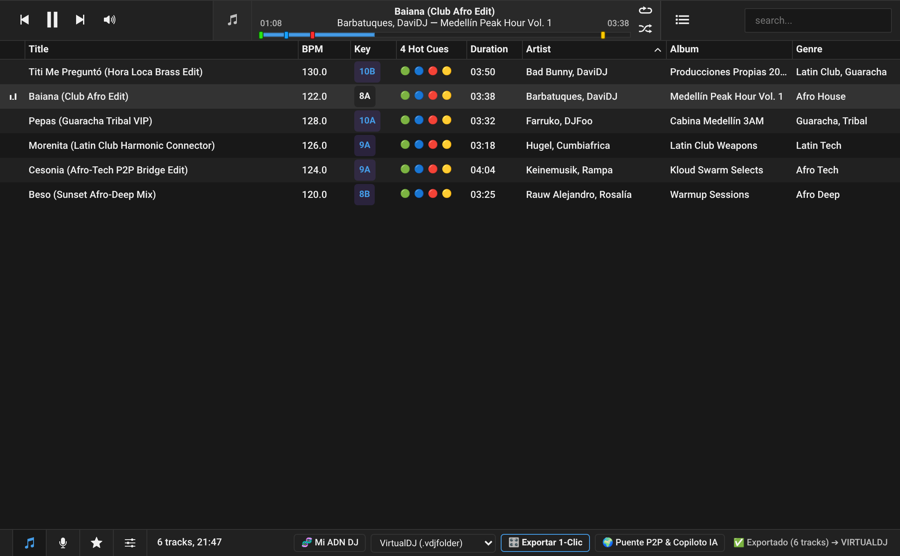
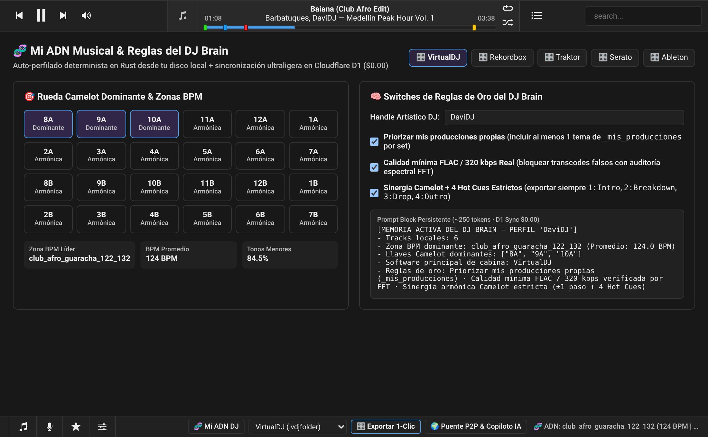
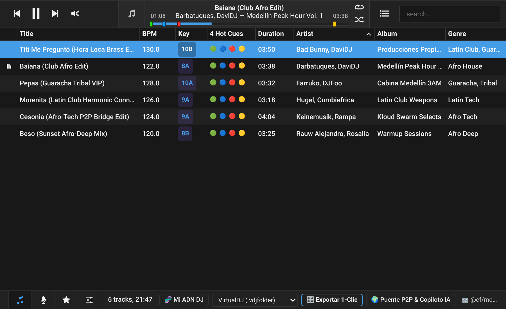

# 🎛️ HERA Desktop (`hera-desktop`)

### _El Centro de Mando Pre-Toque para DJs Nerds y Curadores Musicales (`~8 MB` · 100% Rust + Tauri v2 + React 19 + StyleX)_

**HERA Desktop** es la aplicación nativa de escritorio de HERA construida sobre la base limpia y probada de [`martpie/museeks` (`v0.23.4`, MIT)](https://github.com/martpie/museeks), extendida con el motor acústico puro en Rust ([`hera-rs`](../hera-rs)) para convivir en la misma laptop donde corres **VirtualDJ**, **Rekordbox**, **Traktor** o **Serato** con **0% de consumo parásito de RAM/CPU** y **cero dependencia de Python**.

---

## 📸 Capturas Reales en Vivo (`vp build` + Playwright Chromium)

### 1. Biblioteca DJ + Reproductor Superior con 4 Pines de Hot Cues (`1100x680`)



### 2. Mi ADN Musical & Rueda Camelot de 24 Llaves (`/dna`)



### 3. Puente Armónico Inteligente P2P + Pre-Escucha 15s + Copiloto IA (`/bridge`)


### 4. Vista Compacta de Cabina (`900x550`)



---

## 🚀 ¿Qué hace esta interfaz por nuestros DJs Nerds y Curadores?

### 1. 🎧 Audición Instantánea de Estructura Acústica (Sin perder horas marcando Cues a mano)

- **El dolor del curador:** Cuando un DJ descarga 50 canciones nuevas, tarda horas abriendo una por una para buscar dónde empieza el beat limpio, dónde cae el breakdown, dónde revienta el drop y dónde sacar la mezcla.
- **Lo que hace HERA Desktop (`TrackProgress.tsx` + `TrackRow.tsx`):**
  - En la tabla virtualizada ves de un vistazo el `BPM`, la llave `Camelot` con alto contraste y el estado de los `4 Hot Cues` (`🟢 🔵 🔴 🟡`).
  - Al darle doble clic a cualquier pista, en la barra superior aparecen clavados los **4 pines interactivos**:
    - `🟢 Cue 1 (Intro)`: primer downbeat limpio para meter el tema.
    - `🔵 Cue 2 (Breakdown)`: caída vocal/melódica.
    - `🔴 Cue 3 (Drop)`: pico de energía e impacto de subgraves.
    - `🟡 Cue 4 (Outro / Mix Out)`: punto exacto para empezar a mezclar la siguiente canción.
  - Con **1 clic sobre cada pin**, el curador salta al segundo exacto y comprueba en 5 segundos si el tema funciona para su set.

### 2. 🧬 Radiografía de Identidad Musical y "Reglas de Oro" (`/dna`)

- **El dolor del DJ nerd:** Cada DJ tiene su sello (su rango de BPM favorito, sus llaves menores/mayores preferidas y sus propias producciones o edits), pero ningún software de DJ entiende esa identidad global.
- **Lo que hace HERA Desktop (`dna.tsx` + `dj_brain.rs`):**
  - Escanea los tracks locales en Rust (0% de internet requerido) y pinta la **Rueda Camelot completa de 24 llaves (`1A..12A` y `1B..12B`)**, mostrando las llaves dominantes reales y la zona líder (ej. `club_afro_guaracha_122_132`).
  - Ofrece **switches físicos de Reglas de Oro**:
    1. _Priorizar mis producciones propias (`_mis_producciones`)_ para nunca olvidar tocar tus propios edits.
    2. _Bloquear transcodes falsos (auditoría espectral FFT)_ para que ningún MP3 de 128 kbps inflado a FLAC ensucie el sonido del club.
    3. _Sinergia Camelot estricta + 4 Hot Cues obligatorios_.

### 3. 🌍 El "Puente Armónico Imposible" + Pre-Escucha del Cruce (`/bridge`)

- **El dolor del curador:** Querer pasar de un groove a `118 BPM en 8A` (ej. _Baiana_) a un himno de hora pico a `130 BPM en 10A` (ej. _Pepas_) sin hacer un cambio brusco ni deformar las voces subiendo +10% el pitch.
- **Lo que hace HERA Desktop (`bridge.tsx` + `synergy.rs`):**
  - Defines la **Pista Origen (Deck A)** y la **Pista Destino (Deck B)**.
  - HERA busca en el enjambre P2P comunitario los **2 eslabones puente exactos** que conectan gradualmente el BPM (`118` ➔ `122.2` ➔ `126.6` ➔ `130`) y la armonía Camelot (`8A` ➔ `9A` ➔ `10A`).
  - **Pre-escucha de 15s (`🎧 Pre-escuchar Transición`):** Salta directo al `Cue 4 (Mix Out)` para escuchar cómo empasta la salida con el `Cue 1 (Intro)` antes de descargarla.
  - **Descarga Física Segura (`📥 Descargar al Disco Local`):** Baja el archivo verificado por `hera_seal` pasando primero por `quarantine/` (auditoría FFT) y luego directo a `library/` en el disco duro local.

### 4. 🎛️ Exportación Determinista en 1 Clic a tu Software de Cabina (`HeraDjToolbar.tsx`)

- **El dolor del DJ en vivo:** Estar en una cabina sin internet (o con Wi-Fi inestable) y necesitar pasar el crate curado a tu programa de mezcla con todos los Hot Cues ya puestos.
- **Lo que hace HERA Desktop (`HeraDjToolbar.tsx` + `export.rs`):**
  - Sin depender de ningún LLM ni conexión a internet, eliges en el selector inferior **`VirtualDJ (.vdjfolder)`**, **`Rekordbox (.xml)`**, **`Traktor Pro (.nml)`** o **`M3U8`** y pulsas **`🎛️ Exportar 1-Clic`**.
  - HERA escribe los archivos nativos con las etiquetas `<Poi>`, `<POSITION_MARK>` o `<CUE_V2>` para que cuando abras VirtualDJ/Rekordbox/Traktor, **los 4 Hot Cues ya estén pintados en los pads del controlador**.

### 5. ⚡ Copiloto IA Gratuito (`$0.00`) + Motor `~8 MB` que no ahoga la Laptop

- **0% de sobrecarga en cabina:** Al ser **100% Rust + Tauri v2 + StyleX**, el instalador pesa `~8 MB` y no levanta Python ni modelos pesados en la RAM de la laptop mientras corre el audio en vivo.
- **IA accesible para cualquier DJ de LATAM:** Con `Cloudflare Workers AI Free` (`10,000 Neurons/día` gratis = ~1,500 consultas/día a `$0.00`), el curador puede pedir sets o puentes en lenguaje natural inyectando automáticamente su `DJ Brain`, y los DJs más _nerds_ pueden además conectar Claude, Cursor o Antigravity por **MCP (`hera-node --mcp`)** con las 22 herramientas nativas en Rust (incluyendo el optimizador `build_set_spine` con `2-Opt TSP` restringido).

---

## 🛠️ Comandos de Desarrollo y Verificación (`Vite+` & `Tauri v2`)

```bash
# Instalar dependencias
pnpm install

# Verificar formato (Oxfmt), linter y tipos (Oxlint)
./node_modules/.bin/vp check

# Compilar bundle de producción frontend
./node_modules/.bin/vp build

# Ejecutar tests unitarios
./node_modules/.bin/vp test run --project unit

# Ejecutar modo desarrollo de escritorio (Vite + Tauri v2)
./node_modules/.bin/vp run tauri dev
```
